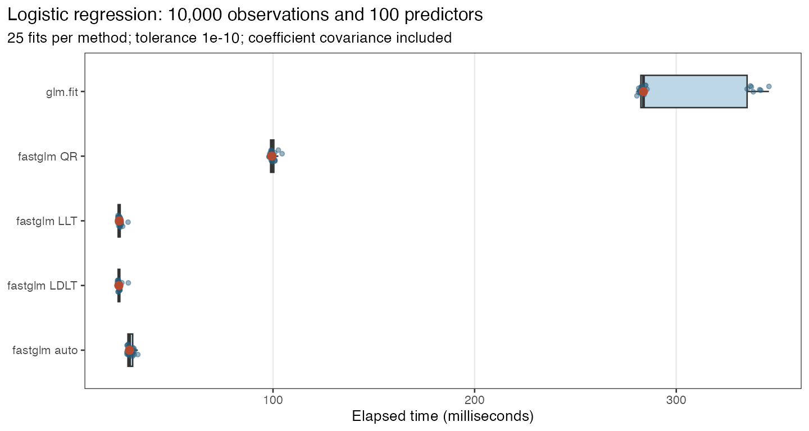
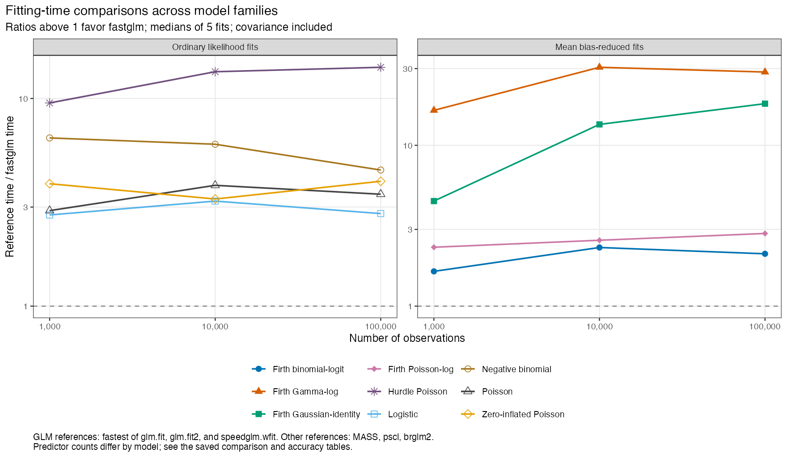

<!-- README.md is generated from README.Rmd. Please edit that file. -->

```{r setup, include=FALSE}
knitr::opts_chunk$set(collapse=TRUE, comment="#>", message=FALSE,
                     fig.align="center", fig.path="man/figures/README-")
```

[](https://cran.r-project.org/package=fastglm)
[](https://cran.r-project.org/package=fastglm)

# fastglm

The *fastglm* package fits generalized linear models with an emphasis on **speed and numerical stability**. Its C++ fitting routines use *RcppEigen* for the repeated weighted regressions at the center of GLM estimation. Formula and matrix interfaces support familiar R workflows, including `summary()`, `coef()`, `vcov()`, `predict()`, `residuals()`, and `logLik()`.

Beyond standard GLMs, *fastglm* provides negative-binomial regression, hurdle and zero-inflated count models, zero-truncated regression, two-part models for positive continuous outcomes, and Firth mean bias reduction. The same package supports sparse matrices, mapped matrices, and data read in blocks, making it useful when either repeated fitting or data size becomes a computational constraint.

See [NEWS](NEWS.md) for the package's version history.

### Features

- **Fast fitting with a choice of solvers.** Six matrix decomposition methods and an automatic option allow the weighted regressions to be adapted to the design. The timing comparisons below include numerical agreement checks.
- **Numerical safeguards.** Step-halving shortens unsuccessful updates in ordinary GLM fitting. Pivoted QR identifies redundant predictors, and explicit Cholesky methods report singular or poorly conditioned systems.
- **Bias reduction and additional response models.** Supported likelihood families can use `firth=TRUE`; logistic Firth fits also support profile intervals and joint tests. Dedicated count and two-part models distinguish zero outcomes from positive responses.
- **Large-data support.** Sparse `Matrix::dgCMatrix` designs, `bigmemory::big.matrix` objects, and repeatable block readers support different memory and storage needs. Optional Arrow and DBI adapters read Parquet files and database results.
- **Inference and prediction.** Model-based, robust, and clustered standard errors are available, together with average predictions and contrasts, bootstrap uncertainty, numerical diagnostics, and optional broom methods.
- **Repeated fits.** Prepared designs reuse common calculations across outcomes. Batch fits support Firth adjustment and independent R workers, with controls for retaining data and computing covariance matrices.

[Installation](#installation) · [Fitting a GLM](#fitting-a-glm) · [Speed](#speed) · [Stability](#stability) · [Extended models](#extended-models) · [Benchmarks](#benchmarks)

## Installation

Install the released version from CRAN or the development version from GitHub:

```{r, eval=FALSE}
install.packages("fastglm")
pak::pak("jaredhuling/fastglm")
```

## Fitting a GLM

`fastglm()` accepts a numeric design matrix, a response, and an R `family` object. In the `esoph` example, the two response columns contain the numbers of cases and controls within each covariate group:

```{r}
library(fastglm)
data(esoph)
X_esoph <- model.matrix(~ agegp + unclass(tobgp) + unclass(alcgp), data=esoph)
y_esoph <- cbind(esoph$ncases, esoph$ncontrols)

fit <- fastglm(X_esoph, y_esoph, family=binomial("cloglog"))
summary(fit)
```

A formula and data frame can also be supplied directly. Formula fits retain factor coding, contrasts, and offsets for subsequent prediction:

```{r}
fit_formula <- fastglm(
    cbind(ncases, ncontrols) ~ agegp + unclass(tobgp) + unclass(alcgp),
    data=esoph, family=binomial("cloglog"))
predict(fit_formula, newdata=esoph[1:3,], type="response", se.fit=TRUE)
```

The fitting function can still be supplied to base R's `glm()`:

```{r, eval=FALSE}
glm(cbind(ncases, ncontrols) ~ agegp + unclass(tobgp) + unclass(alcgp),
    data=esoph, family=binomial("cloglog"), method=fastglm_fit)
```

`fastglmPure()` exposes the lower-level fit without the final dispersion, AIC, and null-deviance calculations performed by `fastglm()`. For workflows that only need coefficient estimates, `fastglm(..., inference="none")` skips the final covariance calculation. Prepared designs, described below, are useful when several outcomes share the same predictors.

## Decomposition methods

Iteratively reweighted least squares (IRLS) fits a GLM through a sequence of weighted linear regressions. A matrix decomposition arranges each regression calculation so that its coefficients can be solved numerically. *fastglm* provides six explicit methods through *RcppEigen* (Bates and Eddelbuettel, 2013), together with an automatic choice:

| Name | Integer | Decomposition or selection rule |
|:--|:--:|:--|
| `"qr"` | `0` | Column-pivoted Householder QR; the default for dense `fastglm()` fits |
| `"qr_unpivoted"` | `1` | Householder QR without column pivoting |
| `"llt"` | `2` | LLT Cholesky |
| `"ldlt"` | `3` | LDLT Cholesky |
| `"qr_full"` | `4` | Full-pivoted Householder QR |
| `"svd"` | `5` | Bidiagonal divide-and-conquer singular value decomposition |
| `"auto"` | | Scale columns, attempt LLT, and fall back to pivoted QR for a problematic dense system |

Pivoted QR can identify redundant columns, allowing aliased coefficients to be reported as `NA`. Cholesky works with the smaller predictor crossproduct and can be faster when the design is well conditioned, meaning that small numerical errors are not strongly amplified. Explicit Cholesky fits require full column rank and report an error when the information matrix is singular or ill conditioned. Sparse, mapped, and streaming fits currently use Cholesky methods.

```{r, eval=FALSE}
fastglm(X, y, family=binomial(), method="qr")
fastglm(X, y, family=binomial(), method="llt")
fastglm(X, y, family=binomial(), method="auto")
```

## Speed

The C++ implementation reduces repeated work in fitting and offers several ways to solve the weighted regressions. The resulting speed advantage depends on the family, the number of rows and columns, the solver, and the requested inference. The following comparison uses a logistic-regression design with 10,000 observations, 100 predictors, and 25 timing repetitions per method.

```{r, eval=FALSE}
set.seed(123)
n.obs <- 10000
n.vars <- 100
X <- matrix(rnorm(n.obs*n.vars, sd=3), n.obs, n.vars)
y <- as.numeric(drop(X[,1:25] %*% runif(25, -.1, .1)) > rnorm(n.obs))

# Include coefficient covariance computation in each timed fit.
with_covariance <- function(fit, raw_glm=FALSE) {
    if (raw_glm) class(fit) <- c("glm", "lm")
    fit$benchmark.covariance <- vcov(fit)
    fit
}
microbenchmark::microbenchmark(
    glm.fit = with_covariance(glm.fit(X, y, family=binomial(), intercept=FALSE,
        control=glm.control(epsilon=1e-10, maxit=100)), raw_glm=TRUE),
    fastglm_QR = with_covariance(fastglm(X, y, binomial(), method="qr", tol=1e-10)),
    fastglm_LLT = with_covariance(fastglm(X, y, binomial(), method="llt", tol=1e-10)),
    fastglm_LDLT = with_covariance(fastglm(X, y, binomial(), method="ldlt", tol=1e-10)),
    fastglm_auto = with_covariance(fastglm(X, y, binomial(), method="auto", tol=1e-10)),
    times=25L
)
```

```{r benchmark-data, include=FALSE}
benchmark_directory <- "benchmarks/readme-results"
focused_benchmark <- read.csv(file.path(benchmark_directory, "focused-summary.csv"))
scaling_benchmark <- read.csv(file.path(benchmark_directory, "scaling-summary.csv"))
benchmark_metadata <- readRDS(file.path(benchmark_directory, "metadata.rds"))
```

These measurements were recorded on **`r substr(benchmark_metadata$timestamp_utc, 1, 10)` (UTC)** with *fastglm* **`r benchmark_metadata$fastglm_version`** and `r benchmark_metadata$R` on `r benchmark_metadata$system[["sysname"]]` (`r benchmark_metadata$system[["machine"]]`). The saved environment and individual timings accompany the benchmark script.



The table reports median elapsed time and the largest absolute differences from `glm.fit()` in coefficients and fitted probabilities. All methods must converge and pass the numerical comparison before they are timed. Timed fits include their ordinary covariance calculations.

```{r focused-results, echo=FALSE, results='asis'}
focused_table <- focused_benchmark[,c("method", "median_ms", "coefficient_error", "mean_error")]
focused_table$coefficient_error <- formatC(focused_table$coefficient_error, format="e", digits=2)
focused_table$mean_error <- formatC(focused_table$mean_error, format="e", digits=2)
knitr::kable(focused_table,
             col.names=c("Method", "Median time (ms)", "Max. coefficient difference", "Max. fitted-probability difference"),
             digits=2, row.names=FALSE)
```

For this design, the median time for `glm.fit()` was `r round(focused_benchmark$median_ms[focused_benchmark$method=="glm.fit"], 1)` ms, compared with `r round(focused_benchmark$median_ms[focused_benchmark$method=="fastglm LLT"], 1)` ms for LLT. The coefficient and fitted-probability differences are close to floating-point rounding error, so the faster calculation retains the same fitted model to numerical precision in this example.

`benchmarks/benchmark-readme.R` regenerates these measurements, checks agreement, records the R environment, and builds the figures. The [broader comparison](#benchmarks) below evaluates scaling across model classes.

## Stability

Fitting can become difficult when a proposed coefficient update produces invalid fitted means or moves to a poorer likelihood value. For ordinary GLMs, *fastglm* uses a step-halving safeguard following Marschner (2011): an unsuccessful update is shortened until an acceptable step is found. Its initialization and solver choices also affect the subsequent iterations.

A Gamma model using a square-root link provides one example. The simulated response is highly skewed, and the fitted mean uses a different functional form from the generating model. The calculation below uses the same iteration limit and nominal tolerance for both fitting methods:

```{r stability}
set.seed(1)
X_stability <- matrix(rnorm(10000*100), ncol=100)
y_stability <- exp(.25*X_stability[,1] - .25*X_stability[,3] +
                   .5*X_stability[,4] - .5*X_stability[,5] + rnorm(10000)) + .1
gfit_fast <- fastglm(y_stability ~ X_stability, family=Gamma("sqrt"),
                     tol=1e-8, maxit=100)
gfit_base <- suppressWarnings(glm(y_stability ~ X_stability,
    family=Gamma("sqrt"), control=glm.control(epsilon=1e-8, maxit=100)))
data.frame(method=c("fastglm", "glm"),
           converged=c(gfit_fast$converged, gfit_base$converged),
           iterations=c(gfit_fast$iter, gfit_base$iter),
           log_likelihood=c(as.numeric(logLik(gfit_fast)), as.numeric(logLik(gfit_base))))
```

`r if (!gfit_base$converged) sprintf("In this run, *fastglm* converged in %d iterations, while glm reached its limit of %d iterations without convergence.", gfit_fast$iter, gfit_base$iter) else sprintf("In this run, both methods converged: *fastglm* in %d iterations and glm in %d.", gfit_fast$iter, gfit_base$iter)`

Convergence status matters when comparing likelihoods or runtimes: an unfinished fit is not an alternative estimate of the same quality. The [computational stability vignette](vignettes/fastglm.Rmd) includes comparisons with `glm2` and `speedglm`, and `fastglm_diagnostics()` reports convergence, the chosen solver, aliased coefficients, and numerical diagnostics for a fitted model.

## Native C++ families

For recognized family/link combinations, variance, mean derivatives, inverse links, and deviance contributions are evaluated directly in C++. This reduces repeated calls from the fitting loop back into R. The current native combinations are:

| Family | Links |
|:--|:--|
| Gaussian | identity, log, inverse |
| Binomial | logit, probit, complementary log-log, log |
| Poisson | log, identity, square root |
| Gamma | log, inverse, identity |
| Inverse Gaussian | inverse squared (`1/mu^2`), log, identity, inverse |
| Negative binomial with fixed theta | log, identity, square root |
| Tweedie with specified variance power | log, identity, inverse, square root |

Quasibinomial and quasipoisson fits share the corresponding mean and variance calculations, with dispersion handled separately. Family detection checks the supplied functions as well as the family name, so a modified family retains its R behavior. Other valid R family/link combinations use the supplied R functions. Firth bias reduction has a narrower supported scope, described below and in its vignette.

## Sparse, big.matrix, and streaming designs

Different storage formats suit different datasets:

- **`Matrix::dgCMatrix`** stores only nonzero predictor entries. It can be passed directly to `fastglm()`, for example when indicator variables produce a mostly zero design.
- **`bigmemory::big.matrix`** provides a mapped view of predictors, which may be backed by a file. Fitting reads row blocks without making a complete ordinary R-matrix copy.
- **`fastglm_streaming()`** repeatedly requests manageable blocks from a supplied function, called a callback. This supports data that need to be read from an external source or constructed as fitting proceeds.

The following example divides one dataset into four blocks and compares the fitted coefficients with an in-memory fit:

```{r streaming}
set.seed(321)
n <- 4000
X_stream <- cbind(1, matrix(rnorm(n*3), n, 3))
y_stream <- rbinom(n, 1, plogis(X_stream %*% c(.2, .4, -.2, .3)))
chunks <- function(k) {
    rows <- ((k-1)*1000+1):(k*1000)
    list(X=X_stream[rows,,drop=FALSE], y=y_stream[rows])
}
fit_stream <- fastglm_streaming(chunks, n_chunks=4, family=binomial(), tol=1e-10)
fit_full <- fastglm(X_stream, y_stream, binomial(), method="llt", tol=1e-10)
max(abs(coef(fit_stream)-coef(fit_full)))
```

`fastglm_source()` combines a repeatable reader with formula information, keeping factor coding and transformations consistent across blocks. Optional `fastglm_source_arrow()` and `fastglm_source_dbi()` adapters read Parquet files and database queries. Each read must reproduce the same observations in the same order throughout fitting and inference.

Predictions normally accumulate in a vector. When that output is too large, `sink` accepts a function that receives one block of results at a time and saves or summarizes it. Here only the mean prediction in each block is retained:

```{r}
block_means <- numeric(4)
predict(fit_stream, type="response",
        sink=function(value, k) block_means[k] <<- mean(value))
block_means
```

Robust covariance and average predictions can also read the source in blocks. Clustered inference additionally stores a contribution vector for each group, and collecting all predictions still requires storage proportional to the number of observations. The [large-data vignette](vignettes/large-data-fastglm.Rmd) explains these memory and repeated-read costs, including the Firth calculations reused across passes.

## Extended models

### Negative-binomial regression

`fastglm_nb()` estimates negative-binomial regression coefficients together with the size parameter theta, which determines variation beyond the Poisson variance. Dense fits alternate coefficient and theta updates in C++, in the spirit of `MASS::glm.nb()`:

```{r}
set.seed(123)
n <- 5000
X_nb <- cbind(1, matrix(rnorm(n*3), n, 3))
mu_nb <- exp(X_nb %*% c(.5, .4, -.2, .3))
y_nb <- MASS::rnegbin(n, mu=mu_nb, theta=2)
f_nb <- fastglm_nb(X_nb, y_nb)
c(coef(f_nb), theta=f_nb$theta)
```

Sparse designs and repeatable sources are also supported. `vcov(f_nb, full=TRUE)` includes theta jointly with the coefficients, and `fastglm_confint_theta()` obtains a profile-likelihood interval by varying theta and refitting the coefficients. The [negative-binomial stability vignette](vignettes/nb-stability-fastglm.Rmd) examines challenging cases and the limit as the model approaches a Poisson distribution.

### Hurdle models

A hurdle model combines a binary regression for whether an outcome is positive with a zero-truncated regression for its positive count. It is useful when the occurrence of an event and its positive frequency need separate explanations. `fastglm_hurdle()` supports Poisson and negative-binomial count components, corresponding to the models in `pscl::hurdle()` (Zeileis, Kleiber, and Jackman, 2008).

```{r hurdle}
set.seed(123)
n <- 5000
x1 <- rnorm(n)
x2 <- rnorm(n)
lambda <- exp(.7 + .4*x1 - .3*x2)
is_positive <- rbinom(n, 1, plogis(-.4 + .5*x1 + .2*x2))
positive_counts <- integer(n)
for (i in seq_len(n)) {
    repeat {
        value <- rpois(1, lambda[i])
        if (value > 0) { positive_counts[i] <- value; break }
    }
}
hurdle_data <- data.frame(y=is_positive*positive_counts, x1=x1, x2=x2)
f_h <- fastglm_hurdle(y ~ x1+x2 | x1+x2, data=hurdle_data, dist="poisson")
coef(f_h)
```

The formula before `|` specifies the count predictors; the formula after it specifies the predictors of a positive outcome. These can differ. `fastglm_truncated()` fits the positive-count regression on its own when observations are sampled conditional on being above zero.

### Zero-inflated models

A zero-inflated model allows zeros to arise from both an additional zero component and the count distribution. This distinction changes the meaning of the binary component relative to a hurdle model. `fastglm_zi()` fits Poisson or negative-binomial versions using an expectation-maximization algorithm: it alternates estimating each observation's component membership with updating the component regressions.

```{r zero-inflated}
set.seed(123)
n <- 5000
x1 <- rnorm(n)
x2 <- rnorm(n)
lambda <- exp(.7 + .4*x1 - .3*x2)
extra_zero <- rbinom(n, 1, plogis(-.4 + .5*x1 + .2*x2))
zi_data <- data.frame(y=ifelse(extra_zero==1, 0L, rpois(n, lambda)), x1=x1, x2=x2)
f_zi <- fastglm_zi(y ~ x1+x2, data=zi_data, dist="poisson")
coef(f_zi)
```

Count-model predictions distinguish the overall response mean, the probability of zero, and the means of the fitted components. Prediction standard errors combine uncertainty from the relevant parameters. The [count-model vignette](vignettes/count-firth-fastglm.Rmd) develops the interpretation and inference examples.

### Two-part models for continuous outcomes

`fastglm_twopart()` combines a binary model for a positive outcome with a Gamma model for its positive amount. This is useful for outcomes such as expenditure that are exactly zero for some observations and positive and skewed for others:

```{r two-part}
set.seed(124)
amounts <- data.frame(x=rnorm(1000))
is_positive <- rbinom(1000, 1, plogis(-.3 + .4*amounts$x))
amounts$y <- is_positive*rgamma(1000, shape=2, scale=exp(.5 + .3*amounts$x)/2)
f_two <- fastglm_twopart(y ~ x, data=amounts)
predict(f_two, newdata=amounts[1:3,], type="response", se.fit=TRUE)
```

The overall mean combines the probability of a positive outcome with its conditional mean amount. The [semicontinuous-outcome vignette](vignettes/semicontinuous-fastglm.Rmd) explains this interpretation and illustrates average contrasts, clustered inference, and bootstrap uncertainty.

### Firth bias-reduced GLMs

`firth=TRUE` adjusts the estimating equations to reduce leading small-sample mean bias (Firth, 1993; Kosmidis and Firth, 2009). For logistic regression with a logit link and a full-rank design, the adjustment also yields finite coefficient estimates under separation, where predictors perfectly distinguish successes from failures (Kosmidis and Firth, 2021).

```{r firth}
data(sex2, package="logistf")
X_firth <- model.matrix(~ age+oc+vic+vicl+vis+dia, data=sex2)
f_firth <- fastglm(X_firth, sex2$case, binomial(), firth=TRUE,
                   tol=1e-10, maxit=200)
coef(f_firth)
```

Mean bias reduction supports the implemented binomial, Poisson, Gaussian, Gamma, inverse-Gaussian, and fixed-theta negative-binomial family/link combinations. It is available for dense, sparse, mapped, and streaming fits using the solvers supported by each format. Gamma fitting also adjusts dispersion. Quasi-likelihood and Tweedie families are outside the current bias-reduction interface.

For retained dense binomial-logit Firth fits, profile inference re-estimates the other coefficients as the coefficient of interest varies, retaining the full original bias-reduction penalty. This allows confidence intervals to reflect an asymmetric penalized likelihood:

```{r profile}
profile_ci <- confint(f_firth, parm=c("age", "dia"), method="profile")
cbind(estimate=coef(f_firth)[rownames(profile_ci)], profile_ci)
fastglm_profile_test(f_firth, parm=c("oc", "vic"), null=0)
```

The profile procedures support independent binomial counts and frequency weights. Their chi-square reference is an approximation, and failed optimizations return diagnostics. The [bias-reduction vignette](vignettes/firth-fastglm.Rmd) explains the assumptions and compares the results with `logistf` and `brglm2`.

## Inference and repeated fits

`summary()`, `vcov()`, and `predict(..., se.fit=TRUE)` provide model-based uncertainty. Robust covariance allows variation beyond the fitted variance model; clustered covariance additionally allows dependence within specified independent groups:

```{r, eval=FALSE}
vcov(fit_formula, type="HC1")
vcov(fit_formula, cluster=group_id, type="HC1")

# The sandwich interfaces are also available for ordinary GLMs.
sandwich::vcovHC(fit_formula, type="HC0")
sandwich::vcovCL(fit_formula, cluster=group_id, type="HC1")
```

`fastglm_average()` reports average predictions or specified contrasts with uncertainty. `fastglm_bootstrap()` provides uncertainty by resampling and refitting, with failed fits recorded in its output. The supported covariance calculations depend on the model and estimation method; the [overview](vignettes/fastglm-overview.Rmd) and model-specific vignettes describe those choices.

### Repeated outcomes with a common design

`fastglm_prepare()` records predictors and common weights or offsets. `fastglm_batch()` then fits several responses using that design:

```{r prepared}
set.seed(125)
X_batch <- cbind(1, matrix(rnorm(1000*3), 1000, 3))
mu_batch <- exp(X_batch %*% c(.2, .3, -.2, .1))
Y_batch <- cbind(first=rgamma(1000, shape=2, scale=mu_batch/2),
                 second=rgamma(1000, shape=4, scale=mu_batch/4))
design <- fastglm_prepare(X_batch, firth=TRUE)
batch <- fastglm_batch(design, Y_batch, family=Gamma("log"))
sapply(batch, coef)
```

Gaussian-identity fits can reuse their matrix decomposition because it depends only on predictors and weights. Dense Firth batches with Gaussian-identity, Gamma-log, or Poisson-square-root links can also reuse their decomposition and bias-adjustment setup with the default automatic solver or explicit `"llt"`. Dispersion and response-dependent adjustments remain specific to each outcome. Changes to the predictors or weights invalidate the saved calculations.

`workers` runs independent fits in separate R processes. This can reduce elapsed time when the fitting work is large enough to offset process startup and data-transfer costs. `inference="none"` skips covariance calculation, and `retain.data=FALSE` omits the design and response from the returned models; methods requiring those data then need new data or a refit.

## Benchmarks

The following study compares model classes across increasing sample sizes: ordinary logistic and Poisson fits with `glm.fit`, `glm2`, and `speedglm`; negative-binomial regression with `MASS::glm.nb`; hurdle and zero-inflated Poisson models with `pscl`; and mean bias reduction with `brglm2` using `type="AS_mean"`. Ordinary and Firth GLMs use `method="auto"` in *fastglm*, while the dedicated count-model functions use their default solvers.

For ordinary logistic and Poisson regression, the plotted reference is the fastest of the three comparison functions at each sample size. The other models use the named reference implementation. The ratio is reference time divided by *fastglm* time: a value of two means *fastglm* took half as long. Firth families are shown separately because their computational requirements differ.



The following table gives the comparison at 100,000 observations. Each median uses five timing repetitions after checking convergence and numerical agreement:

```{r scaling-results, echo=FALSE, results='asis'}
largest_benchmark <- scaling_benchmark[scaling_benchmark$n==100000,
    c("model", "p", "fastglm_ms", "reference", "reference_ms", "speedup")]
knitr::kable(largest_benchmark,
    col.names=c("Model", "Design columns", "fastglm (ms)", "Reference", "Reference (ms)", "Time ratio"),
    digits=c(0, 0, 2, 0, 2, 2), row.names=FALSE)
```

At this sample size, the largest time ratio is `r round(max(largest_benchmark$speedup), 1)` for `r largest_benchmark$model[which.max(largest_benchmark$speedup)]`. Gamma bias-reduction fits combine identical prior-weight contributions in the dispersion equation and reuse matrix calculations that remain constant during fitting. These reduce repeated distribution and matrix calculations while preserving the adjusted estimating equations.

These are measurements of the displayed designs and software environment. The benchmark script records the individual timings, agreement checks, package versions, and fitting controls under `benchmarks/readme-results`. The comparisons include ordinary covariance calculation; profile confidence intervals and bootstrap refits are separate analyses. GLM and Firth comparisons use matrix interfaces, and both hurdle and zero-inflated comparisons use formulas. For negative-binomial regression, `fastglm_nb()` takes a matrix while `MASS::glm.nb()` also constructs its design from a formula. Different packages use different convergence criteria, so the numerical comparisons accompany the nominal tolerance settings.

The [benchmark vignette](vignettes/benchmarks-fastglm.Rmd) retains the earlier, dated study, including sparse and mapped-matrix comparisons. Current scripts also cover numerical accuracy (`benchmarks/benchmark.R`), model and weight patterns (`benchmarks/benchmark-models.R`), large-data Firth fitting (`benchmarks/benchmark-firth-backends.R`), and prepared Firth batches (`benchmarks/benchmark-prepared-firth.R`).

## References

- Firth, D. (1993). Bias reduction of maximum likelihood estimates. *Biometrika*, 80(1), 27--38. [doi:10.1093/biomet/80.1.27](https://doi.org/10.1093/biomet/80.1.27)
- Kosmidis, I. and Firth, D. (2009). Bias reduction in exponential family nonlinear models. *Biometrika*, 96(4), 793--804. [doi:10.1093/biomet/asp055](https://doi.org/10.1093/biomet/asp055)
- Kosmidis, I. and Firth, D. (2021). Jeffreys-prior penalty, finiteness and shrinkage in binomial-response generalized linear models. *Biometrika*, 108(1), 71--82. [doi:10.1093/biomet/asaa052](https://doi.org/10.1093/biomet/asaa052)
- Marschner, I. C. (2011). glm2: Fitting generalized linear models with convergence problems. *The R Journal*, 3(2), 12--15. [doi:10.32614/RJ-2011-012](https://doi.org/10.32614/RJ-2011-012)
- Bates, D. and Eddelbuettel, D. (2013). Fast and elegant numerical linear algebra using the RcppEigen package. *Journal of Statistical Software*, 52(5), 1--24. [doi:10.18637/jss.v052.i05](https://doi.org/10.18637/jss.v052.i05)
- Zeileis, A., Kleiber, C., and Jackman, S. (2008). Regression models for count data in R. *Journal of Statistical Software*, 27(8), 1--25. [doi:10.18637/jss.v027.i08](https://doi.org/10.18637/jss.v027.i08)

Use `citation("fastglm")` for the package citation.
