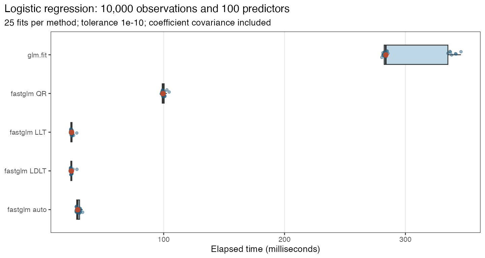
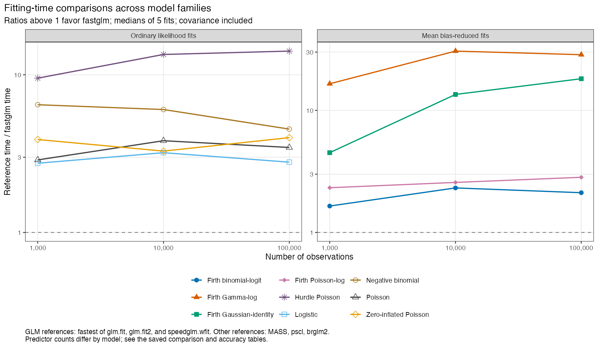
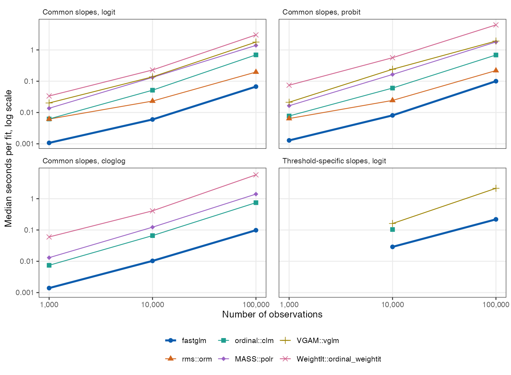
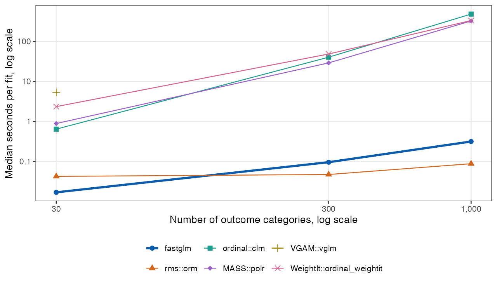
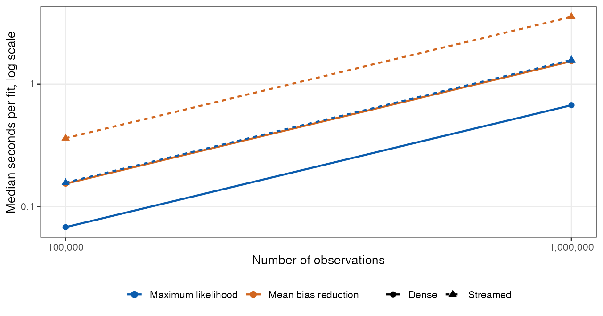

<!-- README.md is generated from README.Rmd. Please edit that file. -->

[](https://cran.r-project.org/package=fastglm)
[](https://cran.r-project.org/package=fastglm)

# fastglm

The *fastglm* package provides fast regression modeling, mean bias
reduction, and inference for continuous, binary, count, and ordered
outcomes. C++ fitting routines and numerical checks support familiar R
workflows, including `summary()`, `coef()`, `vcov()`, `predict()`,
`residuals()`, and `logLik()`.

## Models and estimation

| Model | Main interface | Estimation and examples |
|:---|:---|:---|
| Generalized linear models (GLMs) | `fastglm()` | Ordinary fitting and mean bias reduction for supported family/link combinations; [GLM example](#fitting-a-glm) |
| Negative-binomial counts | `fastglm_nb()` | Maximum likelihood (ML) with estimated size; [negative-binomial regression](#negative-binomial-regression) |
| Positive counts and hurdle models | `fastglm_truncated()`, `fastglm_hurdle()` | Zero-truncated Poisson or negative-binomial regression, alone or with a binary occurrence model; [hurdle examples](#hurdle-models) |
| Zero-inflated counts | `fastglm_zi()` | Poisson or negative-binomial counts with an additional zero component; [zero-inflated models](#zero-inflated-models) |
| Zero and positive continuous outcomes | `fastglm_twopart()` | Binary and Gamma components, with ML or mean bias reduction; [two-part models](#two-part-models-for-continuous-outcomes) |
| Ordered outcomes | `fastglm_ordinal()` | Proportional odds and selected nonparallel effects; logit, probit, and complementary log-log links; ML or mean bias reduction; [ordinal functionality](#ordered-outcomes) |

Mean bias reduction uses `firth=TRUE` where supported. Its scope depends
on the model and family/link combination; the [bias-reduction
section](#firth-bias-reduced-glms) describes the GLM choices. Truncated,
hurdle, and zero-inflated count fitting uses ML.

## Inference and computation

- Uncertainty and testing. Model-based intervals, joint Wald tests,
  robust and clustered covariance, and refitting bootstraps are
  available for supported classes. Profile inference covers dense
  binomial-logit Firth fits, ordinal ML fits with common or
  threshold-specific slopes, and negative-binomial size. Ordinal score
  tests address coefficient hypotheses or the common-slope assumption.
- Prediction and interpretation. Response means or category
  probabilities, prediction standard errors, averages and contrasts,
  residuals, and ordinal calibration summaries connect fitted
  coefficients to outcomes. Shared printed tables and optional broom
  methods support reporting.
- Large datasets. Dense, sparse, mapped, and repeatable-source inputs
  serve different model classes. Streaming supports GLMs,
  negative-binomial, hurdle, two-part, and ordinal models with common or
  threshold-specific slopes.
- Repeated fitting and numerical control. Prepared GLM and ordinal
  designs reuse predictor setup across responses. GLMs offer six
  decompositions and an automatic choice, with diagnostics for
  convergence and numerical conditioning.

The [package overview](vignettes/fastglm-overview.Rmd) maps these
methods to their supported models. Dedicated guides cover [bias
reduction](vignettes/firth-fastglm.Rmd),
[counts](vignettes/count-firth-fastglm.Rmd), [ordered
outcomes](vignettes/ordinal-fastglm.Rmd), [two-part
outcomes](vignettes/semicontinuous-fastglm.Rmd), and [large-data
computation](vignettes/large-data-fastglm.Rmd). See [NEWS](NEWS.md) for
the version history.

[Installation](#installation) · [GLM example](#fitting-a-glm) · [Model
extensions](#extended-models) · [Bias
reduction](#firth-bias-reduced-glms) · [Inference and repeated
fits](#inference-and-repeated-fits) · [Large
data](#sparse-bigmatrix-and-streaming-designs) · [Speed](#speed) ·
[Stability](#stability) · [Benchmarks](#benchmarks)

## Installation

Install the released version from CRAN or the development version from
GitHub:

``` r
install.packages("fastglm")
pak::pak("jaredhuling/fastglm")
```

## Fitting a GLM

`fastglm()` accepts a numeric design matrix, a response, and an R
`family` object. In the `esoph` example, the two response columns
contain the numbers of cases and controls within each covariate group:

``` r
library(fastglm)
data(esoph)
X_esoph <- model.matrix(~ agegp + unclass(tobgp) + unclass(alcgp), data=esoph)
y_esoph <- cbind(esoph$ncases, esoph$ncontrols)

fit <- fastglm(X_esoph, y_esoph, family=binomial("cloglog"))
summary(fit)
#> Generalized linear model
#> 
#> Call:
#> fastglm.default(x = X_esoph, y = y_esoph, family = binomial("cloglog"))
#> Family: binomial (cloglog link)
#> 
#> Coefficients:
#>                Estimate Std. Error z value Pr(>|z|)    
#> (Intercept)    -4.29199    0.29777 -14.414   <1e-04 ***
#> agegp.L         3.30677    0.63456   5.211   <1e-04 ***
#> agegp.Q        -1.35525    0.57311  -2.365    0.018 *  
#> agegp.C         0.20296    0.43334   0.468    0.640    
#> agegp^4         0.15056    0.29318   0.514    0.608    
#> agegp^5        -0.23425    0.17855  -1.312    0.190    
#> unclass(tobgp)  0.33276    0.07285   4.568   <1e-04 ***
#> unclass(alcgp)  0.80384    0.07538  10.664   <1e-04 ***
#> ---
#> Signif. codes:  0 '***' 0.001 '**' 0.01 '*' 0.05 '.' 0.1 ' ' 1
#> 
#>  Dispersion Null deviance Null df Deviance Residual df AIC
#>           1           368      87    96.95          80 228
#> Convergence: converged (6 iterations)
```

A formula and data frame can also be supplied directly. Formula fits
retain factor coding, contrasts, and offsets for subsequent prediction:

``` r
fit_formula <- fastglm(
    cbind(ncases, ncontrols) ~ agegp + unclass(tobgp) + unclass(alcgp),
    data=esoph, family=binomial("cloglog"))
predict(fit_formula, newdata=esoph[1:3,], type="response", se.fit=TRUE)
#> Predictions with standard errors
#> Scale: response mean
#> Residual scale: 1
#> 
#>  Row Estimate Std. Error
#>    1 0.002727   0.002746
#>    2 0.003801   0.003806
#>    3 0.005298   0.005300
```

The fitting function can also be passed to base R’s `glm()`:

``` r
glm(cbind(ncases, ncontrols) ~ agegp + unclass(tobgp) + unclass(alcgp),
    data=esoph, family=binomial("cloglog"), method=fastglm_fit)
```

`fastglmPure()` exposes the lower-level fit without the final
dispersion, AIC, and null-deviance calculations performed by
`fastglm()`. For workflows that only need coefficient estimates,
`fastglm(..., inference="none")` skips the final covariance calculation.
Prepared designs, described below, are useful when several outcomes
share the same predictors.

## Extended models

### Negative-binomial regression

`fastglm_nb()` estimates negative-binomial regression coefficients
together with the size parameter theta, which determines variation
beyond the Poisson variance. Dense fits alternate coefficient and theta
updates in C++, in the spirit of `MASS::glm.nb()`:

``` r
set.seed(123)
n <- 5000
X_nb <- cbind(1, matrix(rnorm(n*3), n, 3))
mu_nb <- exp(X_nb %*% c(.5, .4, -.2, .3))
y_nb <- MASS::rnegbin(n, mu=mu_nb, theta=2)
f_nb <- fastglm_nb(X_nb, y_nb)
c(coef(f_nb), theta=f_nb$theta)
#>         x1         x2         x3         x4      theta 
#>  0.4926199  0.3862258 -0.2200450  0.2991296  1.9923309
```

Sparse designs and repeatable sources are also supported.
`vcov(f_nb, full=TRUE)` includes theta jointly with the coefficients,
and `fastglm_confint_theta()` obtains a profile-likelihood interval by
varying theta and refitting the coefficients. The [negative-binomial
stability vignette](vignettes/nb-stability-fastglm.Rmd) examines
challenging cases and the limit as the model approaches a Poisson
distribution.

### Hurdle models

A hurdle model combines a binary regression for whether an outcome is
positive with a zero-truncated regression for its positive count. It is
useful when the occurrence of an event and its positive frequency need
separate explanations. `fastglm_hurdle()` supports Poisson and
negative-binomial count components, corresponding to the models in
`pscl::hurdle()` (Zeileis, Kleiber, and Jackman, 2008).

``` r
set.seed(123)
n <- 5000
x1 <- rnorm(n)
x2 <- rnorm(n)
lambda <- exp(.7 + .4*x1 - .3*x2)
is_positive <- rbinom(n, 1, plogis(-.4 + .5*x1 + .2*x2))
positive_counts <- integer(n)
for (i in seq_len(n)) {
    repeat {
        value <- rpois(1, lambda[i])
        if (value > 0) { positive_counts[i] <- value; break }
    }
}
hurdle_data <- data.frame(y=is_positive*positive_counts, x1=x1, x2=x2)
f_h <- fastglm_hurdle(y ~ x1+x2 | x1+x2, data=hurdle_data, dist="poisson")
coef(f_h)
#> count_(Intercept)          count_x1          count_x2  zero_(Intercept) 
#>         0.6793788         0.4162547        -0.3137229        -0.3767285 
#>           zero_x1           zero_x2 
#>         0.4447325         0.1999711
```

The formula before `|` specifies the count predictors; the formula after
it specifies the predictors of a positive outcome. These can differ.
`fastglm_truncated()` fits the positive-count regression on its own when
observations are sampled conditional on being above zero.

### Zero-inflated models

A zero-inflated model allows zeros to arise from both an additional zero
component and the count distribution. This distinction changes the
meaning of the binary component relative to a hurdle model.
`fastglm_zi()` fits Poisson or negative-binomial versions using an
expectation-maximization algorithm: it alternates estimating each
observation’s component membership with updating the component
regressions.

``` r
set.seed(123)
n <- 5000
x1 <- rnorm(n)
x2 <- rnorm(n)
lambda <- exp(.7 + .4*x1 - .3*x2)
extra_zero <- rbinom(n, 1, plogis(-.4 + .5*x1 + .2*x2))
zi_data <- data.frame(y=ifelse(extra_zero==1, 0L, rpois(n, lambda)), x1=x1, x2=x2)
f_zi <- fastglm_zi(y ~ x1+x2, data=zi_data, dist="poisson")
coef(f_zi)
#> count_(Intercept)          count_x1          count_x2  zero_(Intercept) 
#>         0.6647396         0.3965153        -0.3407168        -0.3750258 
#>           zero_x1           zero_x2 
#>         0.4512788         0.1819040
```

Count-model predictions distinguish the overall response mean, the
probability of zero, and the means of the fitted components. Prediction
standard errors combine uncertainty from the relevant parameters. The
[count-model vignette](vignettes/count-firth-fastglm.Rmd) develops the
interpretation and inference examples.

### Two-part models for continuous outcomes

`fastglm_twopart()` combines a binary model for a positive outcome with
a Gamma model for its positive amount. This is useful for outcomes such
as expenditure that are exactly zero for some observations and positive
and skewed for others:

``` r
set.seed(124)
amounts <- data.frame(x=rnorm(1000))
is_positive <- rbinom(1000, 1, plogis(-.3 + .4*amounts$x))
amounts$y <- is_positive*rgamma(1000, shape=2, scale=exp(.5 + .3*amounts$x)/2)
f_two <- fastglm_twopart(y ~ x, data=amounts)
predict(f_two, newdata=amounts[1:3,], type="response", se.fit=TRUE)
#> Predictions with standard errors
#> Scale: response mean
#> 
#>  Row Estimate Std. Error
#>    1   0.3117    0.03290
#>    2   0.7218    0.03732
#>    3   0.4540    0.03324
```

The overall mean combines the probability of a positive outcome with its
conditional mean amount. The [semicontinuous-outcome
vignette](vignettes/semicontinuous-fastglm.Rmd) explains this
interpretation and illustrates average contrasts, clustered inference,
and bootstrap uncertainty.

### Ordered outcomes

`fastglm_ordinal()` supports logit, probit, and complementary log-log
cumulative links, with maximum likelihood or mean bias reduction
(`firth=TRUE`). The logit model gives proportional odds with common
slopes and partial proportional odds when selected effects vary through
`nonparallel=~term`.

| Task | Ordinal interface and scope |
|:---|:---|
| Specify the model | Dense formula or matrix; individual outcomes, grouped category frequencies, and offsets; selected nonparallel effects require every category to be observed |
| Interpret predictions | Category and cumulative probabilities, prediction standard errors, average probabilities and contrasts; automatic marginal effects for continuous predictors |
| Test coefficients | Joint Wald tests and named contrasts; ML profile and ordinary or adjusted-score inference for retained dense models with all categories observed |
| Assess common slopes | `fastglm_po_test()` tests the restriction jointly or by term in dense or streamed common-slope and partial fits |
| Assess fit and uncertainty | Prediction scores and calibration for dense or streamed fits; optional row-level boundary diagnostics; robust covariance for eligible fits; refitting bootstraps for retained common-slope fits |
| Repeat fits or read large datasets | `fastglm_ordinal_prepare()` / `fastglm_ordinal_batch()` reuse dense designs; `fastglm_ordinal_streaming()` fits common-slope or partial models from repeatable blocks, including mean bias reduction |

Dense partial fits support robust covariance, marginal effects, ML
profiles, and constrained score tests, including equality of selected
slopes across thresholds. Streamed fits provide model-based or robust
covariance, Wald inference, common-slope tests, prediction scores, and
calibration by rereading their source.
`fastglm_diagnostics(fit,boundary=TRUE)` locates rows near probability
boundaries. Profile intervals and general constrained coefficient-score
tests require retained data. Empty-category behavior also depends on the
model and estimation method. The [ordinal
vignette](vignettes/ordinal-fastglm.Rmd) begins with the full support
guide and develops examples for each workflow.

## Firth bias-reduced GLMs

`firth=TRUE` adjusts the estimating equations to reduce leading
small-sample mean bias (Firth, 1993; Kosmidis and Firth, 2009). For
logistic regression with a logit link and a full-rank design, the
adjustment also yields finite coefficient estimates under separation,
where predictors perfectly distinguish successes from failures (Kosmidis
and Firth, 2021).

``` r
data(sex2, package="logistf")
X_firth <- model.matrix(~ age+oc+vic+vicl+vis+dia, data=sex2)
f_firth <- fastglm(X_firth, sex2$case, binomial(), firth=TRUE,
                   tol=1e-10, maxit=200)
coef(f_firth)
#> (Intercept)         age          oc         vic        vicl         vis 
#>  0.12025405 -1.10598133 -0.06881673  2.26887465 -2.11140819 -0.78831695 
#>         dia 
#>  3.09601183
```

Mean bias reduction supports the implemented binomial, Poisson,
Gaussian, Gamma, inverse-Gaussian, and fixed-theta negative-binomial
family/link combinations. It is available for dense, sparse, mapped, and
streaming fits using the solvers supported by each format. Gamma fitting
also adjusts dispersion. Quasi-likelihood and Tweedie families are not
supported for bias reduction.

For retained dense binomial-logit Firth fits, profile inference
re-estimates the other coefficients as the coefficient of interest
varies, retaining the full original bias-reduction penalty. This allows
confidence intervals to reflect an asymmetric penalized likelihood:

``` r
profile_ci <- confint(f_firth, parm=c("age", "dia"), method="profile")
cbind(estimate=coef(f_firth)[rownames(profile_ci)], profile_ci)
#>      estimate      2.5 %     97.5 %
#> age -1.105981 -1.9737884 -0.3074251
#> dia  3.096012  0.7745682  8.0302935
fastglm_profile_test(f_firth, parm=c("oc", "vic"), null=0)
#> Firth penalized likelihood ratio test (asymptotic chi-square reference)
#> Null fit: Firth penalized likelihood
#> 
#>  Statistic df p-value
#>      28.46  2 < 1e-04
#> 
#> Tested coefficients:
#>     Estimate     Null
#> oc  -0.06882  0.00000
#> vic  2.26887  0.00000
```

The profile procedures support independent binomial counts and frequency
weights. Their chi-square reference is an approximation, and failed
optimizations return diagnostics. The [bias-reduction
vignette](vignettes/firth-fastglm.Rmd) explains the assumptions and
compares the results with `logistf` and `brglm2`.

## Inference and repeated fits

`summary()`, `vcov()`, and `predict(..., se.fit=TRUE)` provide
model-based uncertainty. Robust covariance allows variation beyond the
fitted variance model; clustered covariance additionally allows
dependence within specified independent groups:

``` r
vcov(fit_formula, type="HC1")
vcov(fit_formula, cluster=group_id, type="HC1")

# The sandwich interfaces are also available for ordinary GLMs.
sandwich::vcovHC(fit_formula, type="HC0")
sandwich::vcovCL(fit_formula, cluster=group_id, type="HC1")
```

`fastglm_average()` reports average predictions or specified contrasts
with uncertainty. `fastglm_bootstrap()` provides uncertainty by
resampling and refitting, with failed fits recorded in its output. The
supported covariance calculations depend on the model and estimation
method; the [overview](vignettes/fastglm-overview.Rmd) and
model-specific vignettes describe those choices.

### Repeated outcomes with a common design

`fastglm_prepare()` records predictors and common weights or offsets.
`fastglm_batch()` then fits several responses using that design:

``` r
set.seed(125)
X_batch <- cbind(1, matrix(rnorm(1000*3), 1000, 3))
mu_batch <- exp(X_batch %*% c(.2, .3, -.2, .1))
Y_batch <- cbind(first=rgamma(1000, shape=2, scale=mu_batch/2),
                 second=rgamma(1000, shape=4, scale=mu_batch/4))
design <- fastglm_prepare(X_batch, firth=TRUE)
batch <- fastglm_batch(design, Y_batch, family=Gamma("log"))
sapply(batch, coef)
#>                  first     second
#> (Intercept)  0.1528201  0.2011954
#> X2           0.2764287  0.2982692
#> X3          -0.2119394 -0.1813117
#> X4           0.1212752  0.1062714
```

Gaussian-identity fits can reuse their matrix decomposition because it
depends only on predictors and weights. Dense Firth batches with
Gaussian-identity, Gamma-log, or Poisson-square-root links can also
reuse their decomposition and bias-adjustment setup with the default
automatic solver or explicit `"llt"`. Dispersion and response-dependent
adjustments remain specific to each outcome. Changes to the predictors
or weights invalidate the saved calculations.

`workers` runs independent fits in separate R processes. This can reduce
elapsed time when the fitting work is large enough to offset process
startup and data-transfer costs. `inference="none"` skips covariance
calculation, and `retain.data=FALSE` omits the design and response from
the returned models; methods requiring those data then need new data or
a refit.

## Sparse, big.matrix, and streaming designs

Different storage formats suit different datasets:

- `Matrix::dgCMatrix` stores only nonzero predictor entries. It can be
  passed directly to `fastglm()`, for example when indicator variables
  produce a mostly zero design.
- `bigmemory::big.matrix` provides a mapped view of predictors, which
  may be backed by a file. Fitting reads row blocks without making a
  complete ordinary R-matrix copy.
- `fastglm_streaming()` repeatedly requests manageable blocks from a
  supplied function, called a callback. This supports data that need to
  be read from an external source or constructed as fitting proceeds.

The following example divides one dataset into four blocks and compares
the fitted coefficients with an in-memory fit:

``` r
set.seed(321)
n <- 4000
X_stream <- cbind(1, matrix(rnorm(n*3), n, 3))
y_stream <- rbinom(n, 1, plogis(X_stream %*% c(.2, .4, -.2, .3)))
chunks <- function(k) {
    rows <- ((k-1)*1000+1):(k*1000)
    list(X=X_stream[rows,,drop=FALSE], y=y_stream[rows])
}
fit_stream <- fastglm_streaming(chunks, n_chunks=4, family=binomial(), tol=1e-10)
fit_full <- fastglm(X_stream, y_stream, binomial(), method="llt", tol=1e-10)
max(abs(coef(fit_stream)-coef(fit_full)))
#> [1] 2.775558e-16
```

`fastglm_source()` combines a repeatable reader with formula
information, keeping factor coding and transformations consistent across
blocks. Optional `fastglm_source_arrow()` and `fastglm_source_dbi()`
adapters read Parquet files and database queries. Each read must
reproduce the same observations in the same order throughout fitting and
inference.

Predictions normally accumulate in a vector. When that output is too
large, `sink` accepts a function that receives one block of results at a
time and saves or summarizes it. Here only the mean prediction in each
block is retained:

``` r
block_means <- numeric(4)
predict(fit_stream, type="response",
        sink=function(value, k) block_means[k] <<- mean(value))
block_means
#> [1] 0.5530598 0.5507933 0.5519271 0.5422198
```

Robust covariance and average predictions can also read the source in
blocks. Clustered inference additionally stores a contribution vector
for each group, and collecting all predictions still requires storage
proportional to the number of observations. The [large-data
vignette](vignettes/large-data-fastglm.Rmd) explains these memory and
repeated-read costs, including the Firth calculations reused across
passes.

## Decomposition methods

Iteratively reweighted least squares (IRLS) fits a GLM through a
sequence of weighted linear regressions. A matrix decomposition arranges
each regression calculation so that its coefficients can be solved
numerically. *fastglm* provides six explicit methods through *RcppEigen*
(Bates and Eddelbuettel, 2013), together with an automatic choice:

| Name | Integer | Decomposition or selection rule |
|:---|:--:|:---|
| `"qr"` | `0` | Column-pivoted Householder QR; the default for dense `fastglm()` fits |
| `"qr_unpivoted"` | `1` | Householder QR without column pivoting |
| `"llt"` | `2` | LLT Cholesky |
| `"ldlt"` | `3` | LDLT Cholesky |
| `"qr_full"` | `4` | Full-pivoted Householder QR |
| `"svd"` | `5` | Bidiagonal divide-and-conquer singular value decomposition |
| `"auto"` |  | Scale columns, attempt LLT, and fall back to pivoted QR for a problematic dense system |

For dense fits, pivoted QR can identify redundant columns, allowing
aliased coefficients to be reported as `NA`. Cholesky works with the
smaller predictor crossproduct and can be faster when the design is well
conditioned, meaning that small numerical errors are not strongly
amplified. Explicit Cholesky fits require full column rank and report an
error when the information matrix is singular or ill conditioned. Sparse
and mapped fits use Cholesky methods. Streaming GLMs also support
`method="qr"`, which updates a triangular factor across blocks for
greater stability with nearly redundant predictors. Streaming fits
require full column rank with either method.

``` r
fastglm(X, y, family=binomial(), method="qr")
fastglm(X, y, family=binomial(), method="llt")
fastglm(X, y, family=binomial(), method="auto")
```

## Native C++ families

For recognized family/link combinations, variance, mean derivatives,
inverse links, and deviance contributions are evaluated directly in C++.
This reduces repeated calls from the fitting loop back into R. The
native combinations are:

| Family | Links |
|:---|:---|
| Gaussian | identity, log, inverse |
| Binomial | logit, probit, complementary log-log, log |
| Poisson | log, identity, square root |
| Gamma | log, inverse, identity |
| Inverse Gaussian | inverse squared (`1/mu^2`), log, identity, inverse |
| Negative binomial with fixed theta | log, identity, square root |
| Tweedie with specified variance power | log, identity, inverse, square root |

Quasibinomial and quasipoisson fits share the corresponding mean and
variance calculations, with dispersion handled separately. Family
detection checks the supplied functions as well as the family name, so a
modified family retains its R behavior. Other valid R family/link
combinations use the supplied R functions. Firth bias reduction has a
narrower supported scope, described in the [bias-reduction
section](#firth-bias-reduced-glms) and its vignette.

## Speed

The C++ implementation reduces repeated work in fitting and offers
several ways to solve the weighted regressions. The resulting speed
advantage depends on the family, the number of rows and columns, the
solver, and the requested inference. The following comparison uses a
logistic-regression design with 10,000 observations, 100 predictors, and
25 timing repetitions per method.

``` r
set.seed(123)
n.obs <- 10000
n.vars <- 100
X <- matrix(rnorm(n.obs*n.vars, sd=3), n.obs, n.vars)
y <- as.numeric(drop(X[,1:25] %*% runif(25, -.1, .1)) > rnorm(n.obs))

# Include coefficient covariance computation in each timed fit.
with_covariance <- function(fit, raw_glm=FALSE) {
    if (raw_glm) class(fit) <- c("glm", "lm")
    fit$benchmark.covariance <- vcov(fit)
    fit
}
microbenchmark::microbenchmark(
    glm.fit = with_covariance(glm.fit(X, y, family=binomial(), intercept=FALSE,
        control=glm.control(epsilon=1e-10, maxit=100)), raw_glm=TRUE),
    fastglm_QR = with_covariance(fastglm(X, y, binomial(), method="qr", tol=1e-10)),
    fastglm_LLT = with_covariance(fastglm(X, y, binomial(), method="llt", tol=1e-10)),
    fastglm_LDLT = with_covariance(fastglm(X, y, binomial(), method="ldlt", tol=1e-10)),
    fastglm_auto = with_covariance(fastglm(X, y, binomial(), method="auto", tol=1e-10)),
    times=25L
)
```

Times are for *fastglm* 0.1.3 and R version 4.5.1 (2025-06-13) on Darwin
(arm64).

<figure>

<figcaption aria-hidden="true">Logistic-regression fitting times for
glm.fit and four fastglm solvers. Lower times indicate faster fitting;
the points mark medians.</figcaption>
</figure>

The table reports median elapsed time and the largest absolute
differences from `glm.fit()` in coefficients and fitted probabilities.
Times include ordinary covariance calculations.

| Method | Median time (ms) | Max. coefficient difference | Max. fitted-probability difference |
|:---|---:|:---|:---|
| glm.fit | 283.71 | 0.00e+00 | 0.00e+00 |
| fastglm QR | 99.36 | 1.30e-15 | 6.22e-15 |
| fastglm LLT | 23.77 | 1.22e-15 | 6.55e-15 |
| fastglm LDLT | 23.55 | 1.22e-15 | 6.44e-15 |
| fastglm auto | 28.80 | 9.44e-16 | 5.22e-15 |

For this design, the median time for `glm.fit()` was 283.7 ms, compared
with 23.8 ms for LLT. The coefficient and fitted-probability differences
are close to floating-point rounding error, so the fits agree to
numerical precision.

The [benchmarks](#benchmarks) compare scaling across model classes.

## Stability

Fitting can become difficult when a proposed coefficient update produces
invalid fitted means or moves to a poorer likelihood value. For ordinary
GLMs, *fastglm* uses a step-halving safeguard following Marschner
(2011): an unsuccessful update is shortened until an acceptable step is
found. Its initialization and solver choices also affect the subsequent
iterations.

A Gamma model using a square-root link provides one example. The
simulated response is highly skewed, and the fitted mean uses a
different functional form from the generating model. The calculation
below uses the same iteration limit and nominal tolerance for both
fitting methods:

``` r
set.seed(1)
X_stability <- matrix(rnorm(10000*100), ncol=100)
y_stability <- exp(.25*X_stability[,1] - .25*X_stability[,3] +
                   .5*X_stability[,4] - .5*X_stability[,5] + rnorm(10000)) + .1
gfit_fast <- fastglm(y_stability ~ X_stability, family=Gamma("sqrt"),
                     tol=1e-8, maxit=100)
gfit_base <- suppressWarnings(glm(y_stability ~ X_stability,
    family=Gamma("sqrt"), control=glm.control(epsilon=1e-8, maxit=100)))
data.frame(method=c("fastglm", "glm"),
           converged=c(gfit_fast$converged, gfit_base$converged),
           iterations=c(gfit_fast$iter, gfit_base$iter),
           log_likelihood=c(as.numeric(logLik(gfit_fast)), as.numeric(logLik(gfit_base))))
#>    method converged iterations log_likelihood
#> 1 fastglm      TRUE         19      -16046.66
#> 2     glm     FALSE        100      -16068.27
```

*fastglm* converged in 19 iterations, while glm reached its limit of 100
iterations without convergence.

Convergence status matters when comparing likelihoods or runtimes: an
unfinished fit is not an alternative estimate of the same quality. The
[computational stability vignette](vignettes/fastglm.Rmd) includes
comparisons with `glm2` and `speedglm`, and `fastglm_diagnostics()`
reports convergence, the chosen solver, aliased coefficients, and
numerical diagnostics for a fitted model.

## Benchmarks

These comparisons span model classes and sample sizes: ordinary logistic
and Poisson fits with `glm.fit`, `glm2`, and `speedglm`;
negative-binomial regression with `MASS::glm.nb`; hurdle and
zero-inflated Poisson models with `pscl`; and mean bias reduction with
`brglm2` using `type="AS_mean"`. Ordinary and Firth GLMs use
`method="auto"` in *fastglm*, while the dedicated count-model functions
use their default solvers.

For ordinary logistic and Poisson regression, the plotted reference is
the fastest of the three comparison functions at each sample size. The
other models use the named reference implementation. The ratio is
reference time divided by *fastglm* time: a value of two means *fastglm*
took half as long. Firth families are shown separately because their
computational requirements differ.

<figure>

<figcaption aria-hidden="true">Fitting-time ratios across sample sizes,
with separate panels for maximum-likelihood models and Firth mean bias
reduction. Values above one favor fastglm.</figcaption>
</figure>

At 100,000 observations, using medians of five repetitions:

| Model | Design columns | fastglm (ms) | Reference | Reference (ms) | Time ratio |
|:---|---:|---:|:---|---:|---:|
| Logistic | 30 | 59.17 | speedglm.wfit | 165.13 | 2.79 |
| Poisson | 30 | 64.31 | speedglm.wfit | 222.45 | 3.46 |
| Negative binomial | 4 | 124.90 | MASS::glm.nb | 564.95 | 4.52 |
| Hurdle Poisson | 3 | 42.52 | pscl::hurdle | 600.81 | 14.13 |
| Zero-inflated Poisson | 3 | 314.47 | pscl::zeroinfl | 1255.69 | 3.99 |
| Firth binomial-logit | 6 | 39.37 | brglm2::brglmFit | 83.29 | 2.12 |
| Firth Poisson-log | 6 | 36.67 | brglm2::brglmFit | 103.77 | 2.83 |
| Firth Gamma-log | 6 | 36.00 | brglm2::brglmFit | 1028.00 | 28.56 |
| Firth Gaussian-identity | 6 | 11.59 | brglm2::brglmFit | 210.40 | 18.15 |

At this sample size, the largest time ratio is 28.6 for Firth Gamma-log.
Gamma bias-reduction fits combine identical prior-weight contributions
in the dispersion equation and reuse matrix calculations that remain
constant during fitting.

Speed depends on the design and computing environment. Times include
ordinary covariance calculation, but not profile intervals or bootstrap
refits. GLM and Firth comparisons use matrix interfaces, and both hurdle
and zero-inflated comparisons use formulas. For negative-binomial
regression, `fastglm_nb()` takes a matrix while `MASS::glm.nb()` also
constructs its design from a formula. Packages use different convergence
criteria, so every comparison also checks numerical agreement.

The [benchmark vignette](vignettes/benchmarks-fastglm.Rmd) adds sparse
and mapped-matrix comparisons. Code for all comparisons is in the
`benchmarks` directory of the
[repository](https://github.com/jaredhuling/fastglm).

### Ordinal comparison

These comparisons use packages that fit the same cumulative-link models:
`rms::orm`, `ordinal::clm`, `MASS::polr`, `VGAM::vglm`, and
`WeightIt::ordinal_weightit`. Each design has 10 predictors, and times
include coefficient covariance. A time is compared only when that fit
converges and agrees with *fastglm* on the log likelihood and common
slopes.

<figure>

<figcaption aria-hidden="true">Ordinal fitting times across sample sizes
for common and threshold-specific slopes. Lower times indicate faster
fitting.</figcaption>
</figure>

| Link    | Method                     | Seconds | Time ratio |
|:--------|:---------------------------|--------:|-----------:|
| logit   | fastglm                    |   0.067 |        1.0 |
| logit   | rms::orm                   |   0.196 |        2.9 |
| logit   | ordinal::clm               |   0.695 |       10.3 |
| logit   | MASS::polr                 |   1.392 |       20.7 |
| logit   | VGAM::vglm                 |   1.783 |       26.5 |
| logit   | WeightIt::ordinal_weightit |   3.021 |       44.9 |
| probit  | fastglm                    |   0.100 |        1.0 |
| probit  | rms::orm                   |   0.219 |        2.2 |
| probit  | ordinal::clm               |   0.688 |        6.9 |
| probit  | MASS::polr                 |   1.794 |       17.9 |
| probit  | VGAM::vglm                 |   1.920 |       19.2 |
| probit  | WeightIt::ordinal_weightit |   6.300 |       62.9 |
| cloglog | fastglm                    |   0.098 |        1.0 |
| cloglog | ordinal::clm               |   0.747 |        7.6 |
| cloglog | MASS::polr                 |   1.403 |       14.3 |
| cloglog | VGAM::vglm                 |   6.508 |         NA |
| cloglog | WeightIt::ordinal_weightit |   5.783 |       58.8 |

With 100,000 observations and 5 categories, `rms::orm` is the closest
comparison, at 2.9 times the *fastglm* time for logit and 2.2 times for
probit. `rms::orm` was timed for these two links only. For cloglog,
`VGAM::vglm` warned about intersecting predictors and returned a
different fit, so it has no ratio.

`rms::orm` is designed for outcomes with very many distinct values, and
it overtakes *fastglm* between 30 and 300 categories:

<figure>

<figcaption aria-hidden="true">Ordinal fitting times against the number
of outcome categories, with 20,000 observations. Lower times indicate
faster fitting.</figcaption>
</figure>

| Categories | Method                     | Seconds | Time ratio |
|-----------:|:---------------------------|--------:|-----------:|
|         30 | fastglm                    |   0.017 |       1.00 |
|         30 | rms::orm                   |   0.042 |       2.51 |
|         30 | ordinal::clm               |   0.643 |      38.02 |
|         30 | MASS::polr                 |   0.888 |      52.56 |
|         30 | VGAM::vglm                 |   5.331 |     315.44 |
|         30 | WeightIt::ordinal_weightit |   2.352 |     139.15 |
|        300 | fastglm                    |   0.096 |       1.00 |
|        300 | rms::orm                   |   0.047 |       0.49 |
|        300 | ordinal::clm               |  40.457 |     421.96 |
|        300 | MASS::polr                 |  29.138 |     303.90 |
|        300 | WeightIt::ordinal_weightit |  48.617 |     507.07 |
|       1000 | fastglm                    |   0.315 |       1.00 |
|       1000 | rms::orm                   |   0.088 |       0.28 |
|       1000 | ordinal::clm               | 484.423 |    1537.47 |
|       1000 | MASS::polr                 | 325.835 |    1034.14 |
|       1000 | WeightIt::ordinal_weightit | 334.278 |    1060.94 |

With 20,000 observations, `rms::orm` takes 0.5 times the *fastglm* time
at 300 categories and 0.3 times at 1,000, so it is the faster choice in
that range. Most of the *fastglm* time in that range is the
expected-information calculation behind the reported covariance.
`VGAM::vglm` was not run above 30 categories because it would need about
160 GB of memory at 1,000.

For threshold-specific slopes with 1,000 observations, *fastglm*
reported nonconvergence because the best fit with ordered cumulative
probabilities at every row lies on the ordering boundary, so there is no
time comparison at that size. `ordinal::clm` reported convergence with a
higher log likelihood, but its cumulative predictors cross at 3 of the
1,000 rows, which is not a valid probability model at those rows. At
100,000 observations, `ordinal::clm` took 79.3 seconds and reported that
it had not converged, although its log likelihood agreed with *fastglm*,
so it is omitted there as well.

None of these packages fits mean bias-reduced cumulative-link models or
reads ordinal data in blocks. The last column compares each streamed fit
with the dense fit of the same estimator:

<figure>

<figcaption aria-hidden="true">Dense and streamed ordinal fitting times
for maximum likelihood and mean bias reduction. Lower times indicate
faster fitting.</figcaption>
</figure>

| Observations | Fit | Seconds | Largest coefficient difference from dense fit |
|:---|:---|---:|---:|
| 100,000 | Dense ML | 0.066 | 0.0e+00 |
| 100,000 | Dense mean bias reduction | 0.155 | 0.0e+00 |
| 100,000 | Streamed ML | 0.154 | 2.2e-16 |
| 100,000 | Streamed mean bias reduction | 0.369 | 1.1e-16 |
| 1,000,000 | Dense ML | 0.671 | 0.0e+00 |
| 1,000,000 | Dense mean bias reduction | 1.533 | 0.0e+00 |
| 1,000,000 | Streamed ML | 1.596 | 1.1e-16 |
| 1,000,000 | Streamed mean bias reduction | 3.573 | 3.0e-17 |

Streamed fits use blocks of 10,000 rows.

## References

- Firth, D. (1993). Bias reduction of maximum likelihood estimates.
  *Biometrika*, 80(1), 27–38.
  [doi:10.1093/biomet/80.1.27](https://doi.org/10.1093/biomet/80.1.27)
- Kosmidis, I. and Firth, D. (2009). Bias reduction in exponential
  family nonlinear models. *Biometrika*, 96(4), 793–804.
  [doi:10.1093/biomet/asp055](https://doi.org/10.1093/biomet/asp055)
- Kosmidis, I. and Firth, D. (2021). Jeffreys-prior penalty, finiteness
  and shrinkage in binomial-response generalized linear models.
  *Biometrika*, 108(1), 71–82.
  [doi:10.1093/biomet/asaa052](https://doi.org/10.1093/biomet/asaa052)
- Marschner, I. C. (2011). glm2: Fitting generalized linear models with
  convergence problems. *The R Journal*, 3(2), 12–15.
  [doi:10.32614/RJ-2011-012](https://doi.org/10.32614/RJ-2011-012)
- Bates, D. and Eddelbuettel, D. (2013). Fast and elegant numerical
  linear algebra using the RcppEigen package. *Journal of Statistical
  Software*, 52(5), 1–24.
  [doi:10.18637/jss.v052.i05](https://doi.org/10.18637/jss.v052.i05)
- Zeileis, A., Kleiber, C., and Jackman, S. (2008). Regression models
  for count data in R. *Journal of Statistical Software*, 27(8), 1–25.
  [doi:10.18637/jss.v027.i08](https://doi.org/10.18637/jss.v027.i08)

Use `citation("fastglm")` for the package citation.
