This vignette compares *fastglm* with reference implementations across sample sizes and model classes:

- standard GLMs against `stats::glm()`, `glm2::glm.fit2()`, and `speedglm::speedglm.wfit()`,
- the sparse and `big.matrix` solver paths against the dense path,
- negative-binomial regression against `MASS::glm.nb()`,
- Firth bias-reduced GLMs against `brglm2::brglmFit()` and `logistf::logistf()`, including sparse, streaming, and `big.matrix` Firth paths,
- hurdle and zero-inflated count regressions against `pscl::hurdle()` and `pscl::zeroinfl()`.


``` r
library(fastglm)
suppressPackageStartupMessages({
    library(MASS)
    library(pscl)
    library(logistf)
    library(brglm2)
    library(speedglm)
    library(Matrix)
    library(bigmemory)
    library(microbenchmark)
})

bench_unit <- "milliseconds"
.fmt <- function(mb) {
    s <- summary(mb, unit = bench_unit)
    s <- s[, c("expr", "min", "median", "mean", "max")]
    names(s) <- c("expr", "min (ms)", "median (ms)", "mean (ms)", "max (ms)")
    s
}
# Summary of one comparison, as a table.
.fmt_table <- function(mb, caption = NULL) {
    knitr::kable(.fmt(mb), digits = 2, row.names = FALSE, caption = caption)
}
# Median times with one row per method and one column per sample size.
.timing_table <- function(tim) {
    methods <- unique(tim$expr)
    sizes <- sort(unique(tim$n))
    medians <- tapply(tim$median, list(tim$expr, tim$n), identity)[methods, as.character(sizes), drop = FALSE]
    labels <- paste0("n = ", format(sizes, big.mark = ",", scientific = FALSE, trim = TRUE))
    knitr::kable(data.frame(Method = methods, medians, check.names = FALSE, row.names = NULL),
                 col.names = c("Method", labels), digits = 2,
                 caption = "Median time in milliseconds")
}
# Paired medians for fastglm and brglm2, by family and sample size.
.pair_table <- function(tim) {
    keys <- unique(tim[, c("family", "n")])
    median_of <- function(method, i) tim$median[tim$expr == method & tim$family == keys$family[i] & tim$n == keys$n[i]]
    fast <- vapply(seq_len(nrow(keys)), function(i) median_of("fastglm", i), 0)
    reference <- vapply(seq_len(nrow(keys)), function(i) median_of("brglm2", i), 0)
    knitr::kable(data.frame(Family = keys$family, n = format(keys$n, big.mark = ",", scientific = FALSE, trim = TRUE),
                            fastglm = fast, brglm2 = reference, Ratio = reference / fast),
                 col.names = c("Family", "n", "fastglm (ms)", "brglm2 (ms)", "Time ratio"),
                 digits = c(0, 0, 2, 2, 1), row.names = FALSE)
}
# Short scientific notation for numbers placed in the text.
.sci <- function(x) formatC(x, format = "e", digits = 1)
.collect <- function(mb, n) {
    s <- summary(mb, unit = bench_unit)
    data.frame(n = n, expr = as.character(s$expr), median = s$median,
               stringsAsFactors = FALSE)
}
# One style for every figure: fastglm is dominant, its solver variants share a
# color and differ by linetype, and comparison methods stay visible but thinner.
library(ggplot2)
.method_colors <- c(fastglm = "#0B5CAD", fastglm_qr = "#0B5CAD", fastglm_chol = "#0B5CAD",
    fastglm_nb = "#0B5CAD", fastglm_hurdle = "#0B5CAD", fastglm_zi = "#0B5CAD",
    glm.fit = "#D1661F", glm.nb = "#D1661F", brglm2 = "#D1661F", pscl_hurdle = "#D1661F",
    pscl_zi = "#D1661F", speedglm = "#1F9E8F", glm2_fit2 = "#9A62C4")
.method_lines <- function(methods) ifelse(methods == "fastglm_qr", "dashed", "solid")
.method_widths <- function(methods) ifelse(grepl("^fastglm", methods), 1.2, 0.6)
.benchmark_theme <- function() {
    theme_bw(base_size = 12) +
        theme(panel.grid.minor = element_blank(), legend.position = "bottom",
              strip.background = element_blank(), strip.text = element_text(hjust = 0))
}
.size_axis <- function() {
    scale_x_log10(labels = function(x) format(x, big.mark = ",", scientific = FALSE, trim = TRUE))
}
.plot_scaling <- function(df, title, facet = NULL) {
    methods <- unique(as.character(df$expr))
    plot <- ggplot(df, aes(n, median, colour = expr, linetype = expr, linewidth = expr, group = expr)) +
        geom_line() + geom_point(size = 2.2) +
        .size_axis() + scale_y_log10() +
        scale_colour_manual(values = .method_colors[methods], breaks = methods) +
        scale_linetype_manual(values = setNames(.method_lines(methods), methods), breaks = methods) +
        scale_linewidth_manual(values = setNames(.method_widths(methods), methods), breaks = methods) +
        labs(x = "Number of observations, log scale",
             y = paste0("Median time (", bench_unit, "), log scale"),
             title = title, colour = NULL, linetype = NULL, linewidth = NULL) +
        .benchmark_theme()
    if (!is.null(facet)) plot <- plot + facet_wrap(facet, scales = "free_y")
    plot
}
sessionInfo()
#> R version 4.5.1 (2025-06-13)
#> Platform: aarch64-apple-darwin20
#> Running under: macOS Sequoia 15.7.3
#> 
#> Matrix products: default
#> BLAS:   /Library/Frameworks/R.framework/Versions/4.5-arm64/Resources/lib/libRblas.0.dylib 
#> LAPACK: /Library/Frameworks/R.framework/Versions/4.5-arm64/Resources/lib/libRlapack.dylib;  LAPACK version 3.12.1
#> 
#> locale:
#> [1] en_US.UTF-8/en_US.UTF-8/en_US.UTF-8/C/en_US.UTF-8/en_US.UTF-8
#> 
#> time zone: America/Chicago
#> tzcode source: internal
#> 
#> attached base packages:
#> [1] stats     graphics  grDevices utils     datasets  methods   base     
#> 
#> other attached packages:
#>  [1] ggplot2_4.0.1        microbenchmark_1.5.0 bigmemory_4.6.4     
#>  [4] speedglm_0.3-5       biglm_0.9-3          DBI_1.2.3           
#>  [7] Matrix_1.7-5         brglm2_1.1.1         logistf_1.26.1      
#> [10] pscl_1.5.9           MASS_7.3-66          fastglm_0.1.3       
#> 
#> loaded via a namespace (and not attached):
#>  [1] gtable_0.3.6           shape_1.4.6.1          xfun_0.57             
#>  [4] formula.tools_1.7.1    lattice_0.22-7         numDeriv_2016.8-1.1   
#>  [7] vctrs_0.7.2            tools_4.5.1            Rdpack_2.6.4          
#> [10] generics_0.1.4         enrichwith_0.5.0       sandwich_3.1-1        
#> [13] tibble_3.3.0           pan_1.9                pkgconfig_2.0.3       
#> [16] jomo_2.7-6             RColorBrewer_1.1-3     S7_0.2.1              
#> [19] uuid_1.2-1             lifecycle_1.0.5        farver_2.1.2          
#> [22] compiler_4.5.1         statmod_1.5.1          codetools_0.2-20      
#> [25] glmnet_4.1-10          mice_3.18.0            pillar_1.11.1         
#> [28] nloptr_2.2.1           tidyr_1.3.1            reformulas_0.4.1      
#> [31] iterators_1.0.14       rpart_4.1.24           boot_1.3-31           
#> [34] multcomp_1.4-28        foreach_1.5.2          mitml_0.4-5           
#> [37] nlme_3.1-168           tidyselect_1.2.1       mvtnorm_1.3-7         
#> [40] dplyr_1.1.4            purrr_1.2.1            splines_4.5.1         
#> [43] operator.tools_1.6.3.1 grid_4.5.1             cli_3.6.6             
#> [46] magrittr_2.0.4         survival_3.8-3         broom_1.0.12          
#> [49] TH.data_1.1-3          bigmemory.sri_0.1.8    withr_3.0.2           
#> [52] scales_1.4.0           backports_1.5.0        estimability_1.5.1    
#> [55] emmeans_1.11.2         nnet_7.3-20            lme4_1.1-37           
#> [58] zoo_1.8-14             evaluate_1.0.5         knitr_1.51            
#> [61] rbibutils_2.3          mgcv_1.9-3             nleqslv_3.3.5         
#> [64] rlang_1.3.0            Rcpp_1.1.1-1.1         xtable_1.8-4          
#> [67] glue_1.8.0             minqa_1.2.8            R6_2.6.1
```

# Standard GLMs

Logistic regression with an increasing number of observations, holding `p = 30` fixed. Comparing the default *fastglm* path (`method = 0`, pivoted QR), the LLT-Cholesky path (`method = 2`), `stats::glm.fit()`, `glm2::glm.fit2()`, and `speedglm::speedglm.wfit()`.


``` r
set.seed(1)
p <- 30

run_one_logit <- function(n) {
    X <- matrix(rnorm(n * p), n, p)
    beta <- rnorm(p) * 0.05
    y <- rbinom(n, 1, plogis(X %*% beta))
    microbenchmark(
        fastglm_qr   = fastglm(X, y, family = binomial(),            method = 0),
        fastglm_chol = fastglm(X, y, family = binomial(),            method = 2),
        glm.fit      = glm.fit(X, y, family = binomial()),
        glm2_fit2    = glm2::glm.fit2(X, y, family = binomial()),
        speedglm     = speedglm::speedglm.wfit(y = y, X = X,
                                               family = binomial(),
                                               intercept = FALSE),
        times = 5L
    )
}

logit_tim <- list()
for (n in c(1e3, 1e4, 1e5)) {
    mb <- run_one_logit(n)
    logit_tim[[length(logit_tim) + 1]] <- .collect(mb, n)
}
logit_tim <- do.call(rbind, logit_tim)
.timing_table(logit_tim)
```


Table: Median time in milliseconds

|Method       | n = 1,000| n = 10,000| n = 100,000|
|:------------|---------:|----------:|-----------:|
|fastglm_qr   |      1.43|      12.84|      125.61|
|fastglm_chol |      0.79|       5.06|       51.93|
|glm.fit      |      3.03|      32.93|      380.41|
|glm2_fit2    |      3.16|      33.22|      451.84|
|speedglm     |      2.42|      23.57|      286.21|


``` r
.plot_scaling(logit_tim, "Logistic regression: median time vs n (p = 30)")
```

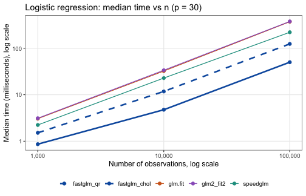

The same comparison for Poisson regression with a log link:


``` r
run_one_poisson <- function(n) {
    X <- matrix(rnorm(n * p), n, p)
    beta <- rnorm(p) * 0.05
    y <- rpois(n, exp(X %*% beta + 1))
    microbenchmark(
        fastglm_qr   = fastglm(X, y, family = poisson(),            method = 0),
        fastglm_chol = fastglm(X, y, family = poisson(),            method = 2),
        glm.fit      = glm.fit(X, y, family = poisson()),
        glm2_fit2    = glm2::glm.fit2(X, y, family = poisson()),
        speedglm     = speedglm::speedglm.wfit(y = y, X = X,
                                               family = poisson(),
                                               intercept = FALSE),
        times = 5L
    )
}

pois_tim <- list()
for (n in c(1e3, 1e4, 1e5)) {
    mb <- run_one_poisson(n)
    pois_tim[[length(pois_tim) + 1]] <- .collect(mb, n)
}
pois_tim <- do.call(rbind, pois_tim)
.timing_table(pois_tim)
```


Table: Median time in milliseconds

|Method       | n = 1,000| n = 10,000| n = 100,000|
|:------------|---------:|----------:|-----------:|
|fastglm_qr   |      1.43|      11.99|      121.73|
|fastglm_chol |      0.82|       4.54|       47.79|
|glm.fit      |      3.12|      30.45|      387.58|
|glm2_fit2    |      3.20|      31.19|      395.62|
|speedglm     |      2.51|      22.57|      235.00|


``` r
.plot_scaling(pois_tim, "Poisson regression: median time vs n (p = 30)")
```

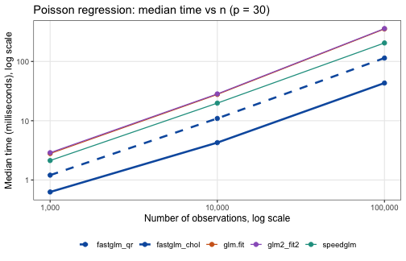

These timings compare two ways to solve the weighted regression in each fitting iteration: QR uses the predictor matrix directly, whereas Cholesky works with its smaller crossproduct. Their costs depend on the numbers of rows and columns, the response family, and the numerical libraries used. The observed ratios apply to the displayed cases; attributing a difference specifically to parallel computation would require a separate comparison with threading controlled.

# Sparse and big.matrix paths

A sparse design matrix from one-hot encoding a 100-level factor against a continuous covariate. The column count is `p = 200`; *fastglm* on the dense matrix stores all 200 columns, while the sparse path operates only on the nonzero entries:


``` r
set.seed(2)
n   <- 5e4
g   <- factor(sample.int(100, n, replace = TRUE))
xn  <- rnorm(n)
Xd  <- model.matrix(~ g * xn)
Xs  <- as(Xd, "CsparseMatrix")
betas <- rnorm(ncol(Xd)) / 4
y   <- rbinom(n, 1, plogis(Xd %*% betas))

mb_sparse <- microbenchmark(
    fastglm_dense  = fastglm(Xd, y, family = binomial(), method = 2),
    fastglm_sparse = fastglm(Xs, y, family = binomial(), method = 2),
    times = 5L
)
.fmt_table(mb_sparse)
```


|expr           | min (ms)| median (ms)| mean (ms)| max (ms)|
|:--------------|--------:|-----------:|---------:|--------:|
|fastglm_dense  |   308.30|      311.63|    311.98|   315.80|
|fastglm_sparse |    24.22|       27.68|     33.06|    47.03|


The design has 200 columns, and 2% of its entries are nonzero.

A `big.matrix` comparison on a large dense design, with `n = 5e5` and `p = 20`. The file-backed `big.matrix` reads blocks of rows and gives the same estimates:


``` r
set.seed(3)
n  <- 5e5
p  <- 20
X  <- matrix(rnorm(n * p), n, p)
Xb <- as.big.matrix(X)
y  <- rbinom(n, 1, plogis(X %*% rnorm(p) * 0.05))

mb_big <- microbenchmark(
    dense       = fastglm(X,  y, family = binomial(), method = 2),
    big.matrix  = fastglm(Xb, y, family = binomial(), method = 2),
    times = 3L
)
.fmt_table(mb_big)
```


|expr       | min (ms)| median (ms)| mean (ms)| max (ms)|
|:----------|--------:|-----------:|---------:|--------:|
|dense      |   176.55|      179.85|    208.01|   267.63|
|big.matrix |   219.15|      221.09|    220.90|   222.47|


``` r

f1 <- fastglm(X,  y, family = binomial(), method = 2)
f2 <- fastglm(Xb, y, family = binomial(), method = 2)
```

The largest coefficient difference between the two fits is 1.2e-15. Reading a file-backed matrix in blocks adds overhead but can reduce the need to copy a large predictor matrix. Another option is to supply blocks through `fastglm_source()` and fit them with `fastglm_streaming()`, as described in the large-data vignette. These choices have different memory requirements and should be compared on the intended data size.

# Negative-binomial regression

`fastglm_nb()` against `MASS::glm.nb()` across a range of sample sizes. The data-generating process is NB(`mu`, `theta = 2`) with three covariates and an intercept:


``` r
set.seed(4)
run_one_nb <- function(n) {
    X  <- cbind(1, matrix(rnorm(n * 3), n, 3))
    mu <- exp(X %*% c(0.5, 0.4, -0.2, 0.3))
    y  <- MASS::rnegbin(n, mu = mu, theta = 2)
    df <- data.frame(y = y, x1 = X[, 2], x2 = X[, 3], x3 = X[, 4])
    microbenchmark(
        fastglm_nb = fastglm_nb(X, y),
        glm.nb     = MASS::glm.nb(y ~ x1 + x2 + x3, data = df),
        times = 5L
    )
}

nb_tim <- list()
for (n in c(1e3, 1e4, 1e5, 5e5)) {
    mb <- run_one_nb(n)
    nb_tim[[length(nb_tim) + 1]] <- .collect(mb, n)
}
nb_tim <- do.call(rbind, nb_tim)
.timing_table(nb_tim)
```


Table: Median time in milliseconds

|Method     | n = 1,000| n = 10,000| n = 100,000| n = 500,000|
|:----------|---------:|----------:|-----------:|-----------:|
|fastglm_nb |      1.80|      12.82|      116.06|      591.15|
|glm.nb     |      8.07|      65.48|      563.15|     2270.57|


``` r
.plot_scaling(nb_tim, "Negative-binomial joint MLE: median time vs n")
```

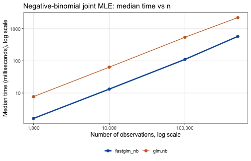

For the largest case, both functions target the same maximum likelihood fit, and numerical agreement also depends on convergence and stopping tolerances. Dense *fastglm* fits perform both coefficient and theta updates in C++, which reduces repeated calls between R and compiled code.


``` r
set.seed(99)
n  <- 5e5
X  <- cbind(1, matrix(rnorm(n * 3), n, 3))
mu <- exp(X %*% c(0.5, 0.4, -0.2, 0.3))
y  <- MASS::rnegbin(n, mu = mu, theta = 2)
df <- data.frame(y = y, x1 = X[, 2], x2 = X[, 3], x3 = X[, 4])
f_nb <- fastglm_nb(X, y)
m_nb <- MASS::glm.nb(y ~ x1 + x2 + x3, data = df)
```

The largest coefficient difference is 2.2e-14, the difference in theta is 9.7e-12, and the difference in log likelihood is 2.3e-09.

# Firth bias-reduced GLMs

Firth bias reduction (Firth, 1993; Kosmidis and Firth, 2009) is supported for all standard GLM families via `firth = TRUE`. We benchmark against `brglm2::brglmFit(type = "AS_mean")`, which implements the same AS_mean adjustment, and against `logistf::logistf()` for the binomial-logit special case.

First, the canonical logistic benchmark on the *sex2* dataset and a larger simulated example:


``` r
data(sex2, package = "logistf")
X_sex2 <- model.matrix(~ age + oc + vic + vicl + vis + dia, data = sex2)
y_sex2 <- sex2$case

mb_firth_logistf <- microbenchmark(
    fastglm = fastglm(X_sex2, y_sex2, family = binomial(), firth = TRUE),
    logistf = logistf(case ~ age + oc + vic + vicl + vis + dia, data = sex2),
    brglm2  = glm(case ~ age + oc + vic + vicl + vis + dia, data = sex2,
                  family = binomial(), method = "brglmFit", type = "AS_mean"),
    times = 10L
)
.fmt_table(mb_firth_logistf, caption = paste0("Heinze-Schemper sex2 data, n = ", nrow(sex2)))
```


Table: Heinze-Schemper sex2 data, n = 239

|expr    | min (ms)| median (ms)| mean (ms)| max (ms)|
|:-------|--------:|-----------:|---------:|--------:|
|fastglm |     0.65|        0.69|      0.78|     1.56|
|logistf |     7.40|        7.46|      7.60|     8.61|
|brglm2  |     2.58|        2.73|      2.98|     5.20|


Next, a comprehensive comparison of `fastglm(firth = TRUE)` against `brglm2` across all supported families and links. We fix `n = 10000` and `p = 5` to see the per-family speedup:


``` r
set.seed(123)
n <- 10000;  p_firth <- 5
X_firth <- cbind(1, matrix(rnorm(n * p_firth), n, p_firth))
eta_firth <- X_firth %*% c(0.5, 0.3, -0.2, 0.1, 0.05, -0.1)

firth_families <- list(
    list(fam = binomial("logit"),       label = "binomial logit",
         y = rbinom(n, 1, plogis(eta_firth))),
    list(fam = binomial("probit"),      label = "binomial probit",
         y = rbinom(n, 1, plogis(eta_firth))),
    list(fam = binomial("cloglog"),     label = "binomial cloglog",
         y = rbinom(n, 1, plogis(eta_firth))),
    list(fam = poisson("log"),          label = "poisson log",
         y = rpois(n, exp(eta_firth))),
    list(fam = poisson("sqrt"),         label = "poisson sqrt",
         y = rpois(n, exp(eta_firth))),
    list(fam = Gamma("log"),            label = "Gamma log",
         y = rgamma(n, shape = 5, rate = 5 / exp(eta_firth))),
    list(fam = gaussian("identity"),    label = "gaussian identity",
         y = as.numeric(eta_firth) + rnorm(n, 0, 0.5)),
    list(fam = gaussian("log"),         label = "gaussian log",
         y = pmax(as.numeric(eta_firth) + rnorm(n, 0, 0.5), 0.01))
)

xnames <- paste0("x", seq_len(p_firth))
df_firth <- data.frame(X_firth[, -1])
names(df_firth) <- xnames
fml_firth <- as.formula(paste("y ~", paste(xnames, collapse = " + ")))

firth_all_tim <- list()
for (fi in firth_families) {
    df_firth$y <- fi$y
    mb <- microbenchmark(
        fastglm = fastglm(X_firth, fi$y, family = fi$fam, firth = TRUE),
        brglm2  = glm(fml_firth, data = df_firth, family = fi$fam,
                      method = "brglmFit", type = "AS_mean"),
        times = 10L
    )
    firth_all_tim[[length(firth_all_tim) + 1]] <-
        transform(.collect(mb, n), family = fi$label)
}
firth_all_tim <- do.call(rbind, firth_all_tim)
.pair_table(firth_all_tim)
```


|Family            |n      | fastglm (ms)| brglm2 (ms)| Time ratio|
|:-----------------|:------|------------:|-----------:|----------:|
|binomial logit    |10,000 |         4.65|       15.25|        3.3|
|binomial probit   |10,000 |         9.44|       16.94|        1.8|
|binomial cloglog  |10,000 |         8.85|       18.40|        2.1|
|poisson log       |10,000 |         5.27|      125.99|       23.9|
|poisson sqrt      |10,000 |         3.04|      124.81|       41.0|
|Gamma log         |10,000 |         3.45|      111.15|       32.2|
|gaussian identity |10,000 |         1.65|       23.43|       14.2|
|gaussian log      |10,000 |         7.33|       33.41|        4.6|


The median time for each family, with each pair of methods joined by a line:


``` r
firth_all_tim$family <- reorder(firth_all_tim$family, firth_all_tim$median, max)
ggplot(firth_all_tim, aes(median, family, colour = expr, group = family)) +
    geom_line(colour = "grey70") + geom_point(size = 2.4) +
    scale_x_log10() +
    scale_colour_manual(values = .method_colors[c("fastglm", "brglm2")], breaks = c("fastglm", "brglm2")) +
    labs(x = paste0("Median time (", bench_unit, "), log scale"), y = NULL, colour = NULL,
         title = paste0("Firth bias-reduced GLMs: fastglm and brglm2 (n = ", n, ")")) +
    .benchmark_theme()
```

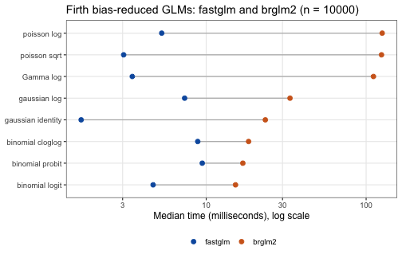

Scaling with sample size for a representative subset of families:


``` r
set.seed(123)
firth_scaling_fams <- list(
    list(fam = binomial("logit"),    label = "binomial logit"),
    list(fam = poisson("log"),       label = "poisson log"),
    list(fam = Gamma("log"),         label = "Gamma log"),
    list(fam = gaussian("identity"), label = "gaussian identity")
)

firth_scale_tim <- list()
for (n_val in c(1e3, 1e4, 5e4)) {
    X_s <- cbind(1, matrix(rnorm(n_val * p_firth), n_val, p_firth))
    eta_s <- X_s %*% c(0.5, 0.3, -0.2, 0.1, 0.05, -0.1)
    df_s <- data.frame(X_s[, -1])
    names(df_s) <- xnames

    for (fi in firth_scaling_fams) {
        y_s <- switch(fi$fam$family,
            "binomial" = rbinom(n_val, 1, plogis(eta_s)),
            "poisson"  = rpois(n_val, exp(eta_s)),
            "Gamma"    = rgamma(n_val, shape = 5, rate = 5 / exp(eta_s)),
            "gaussian" = as.numeric(eta_s) + rnorm(n_val, 0, 0.5)
        )
        df_s$y <- y_s
        mb <- microbenchmark(
            fastglm = fastglm(X_s, y_s, family = fi$fam, firth = TRUE),
            brglm2  = glm(fml_firth, data = df_s, family = fi$fam,
                          method = "brglmFit", type = "AS_mean"),
            times = 5L
        )
        firth_scale_tim[[length(firth_scale_tim) + 1]] <-
            transform(.collect(mb, n_val), family = fi$label)
    }
}
firth_scale_tim <- do.call(rbind, firth_scale_tim)
.pair_table(firth_scale_tim)
```


|Family            |n      | fastglm (ms)| brglm2 (ms)| Time ratio|
|:-----------------|:------|------------:|-----------:|----------:|
|binomial logit    |1,000  |         1.08|        2.63|        2.4|
|poisson log       |1,000  |         2.20|       17.06|        7.8|
|Gamma log         |1,000  |         0.96|       13.46|       14.1|
|gaussian identity |1,000  |         0.65|        4.39|        6.7|
|binomial logit    |10,000 |         6.32|       18.87|        3.0|
|poisson log       |10,000 |         5.17|      131.05|       25.3|
|Gamma log         |10,000 |         5.00|      119.97|       24.0|
|gaussian identity |10,000 |         1.47|       22.64|       15.4|
|binomial logit    |50,000 |        26.29|       79.68|        3.0|
|poisson log       |50,000 |        25.84|      647.87|       25.1|
|Gamma log         |50,000 |        14.83|      537.74|       36.3|
|gaussian identity |50,000 |         5.49|      110.94|       20.2|


``` r

.plot_scaling(firth_scale_tim, "Firth bias reduction: median time by family", facet = ~family)
```

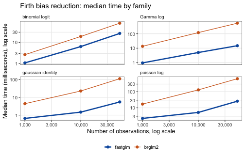

## Firth across all decomposition methods

Firth bias reduction works with all six decomposition methods. This example checks that they give the same coefficients and compares their timings:


``` r
set.seed(123)
n_meth <- 10000;  p_meth <- 10
X_meth <- cbind(1, matrix(rnorm(n_meth * (p_meth - 1)), n_meth, p_meth - 1))
y_meth <- rbinom(n_meth, 1, plogis(X_meth %*% rnorm(p_meth) * 0.1))

ref_coef <- coef(fastglm(X_meth, y_meth, family = binomial(), method = 2, firth = TRUE))
method_names <- c("ColPivQR", "QR", "LLT", "LDLT", "FullPivQR", "SVD")
compared_methods <- c(0L, 1L, 3L, 4L, 5L)
method_differences <- vapply(compared_methods, function(m) {
    max(abs(coef(fastglm(X_meth, y_meth, family = binomial(), method = m, firth = TRUE)) - ref_coef))
}, 0)
knitr::kable(data.frame(Method = method_names[compared_methods + 1], Difference = .sci(method_differences)),
             col.names = c("Method", "Largest coefficient difference from LLT"), row.names = FALSE)
```


|Method    |Largest coefficient difference from LLT |
|:---------|:---------------------------------------|
|ColPivQR  |5.8e-16                                 |
|QR        |6.9e-16                                 |
|LDLT      |8.3e-17                                 |
|FullPivQR |6.7e-16                                 |
|SVD       |3.5e-16                                 |


``` r

mb_methods <- microbenchmark(
    ColPivQR = fastglm(X_meth, y_meth, family = binomial(), method = 0, firth = TRUE),
    QR       = fastglm(X_meth, y_meth, family = binomial(), method = 1, firth = TRUE),
    LLT      = fastglm(X_meth, y_meth, family = binomial(), method = 2, firth = TRUE),
    LDLT     = fastglm(X_meth, y_meth, family = binomial(), method = 3, firth = TRUE),
    FullPivQR= fastglm(X_meth, y_meth, family = binomial(), method = 4, firth = TRUE),
    SVD      = fastglm(X_meth, y_meth, family = binomial(), method = 5, firth = TRUE),
    times = 5L
)
.fmt_table(mb_methods, caption = paste0("Firth logistic regression, n = ", n_meth, ", p = ", p_meth))
```


Table: Firth logistic regression, n = 10000, p = 10

|expr      | min (ms)| median (ms)| mean (ms)| max (ms)|
|:---------|--------:|-----------:|---------:|--------:|
|ColPivQR  |     7.62|        7.84|      8.25|     9.64|
|QR        |     7.04|        7.47|      7.47|     8.04|
|LLT       |     4.79|        5.69|      5.92|     7.13|
|LDLT      |     5.81|        6.40|      6.33|     7.04|
|FullPivQR |  3125.84|     3180.37|   3201.78|  3346.50|
|SVD       |    10.93|       11.53|     12.25|    13.88|


All six methods agree to machine precision. The LLT and LDLT Cholesky methods are the fastest because they only decompose the `p x p` cross-product, while the QR and SVD methods work with the full `n x p` matrix.

## Firth on sparse and streaming designs

This example compares several ways to supply the predictor matrix: ordinary storage, sparse storage of nonzero entries, a `big.matrix`, and a function that reads blocks of rows as needed. Bias reduction uses leverage values, which describe the relative influence of predictor rows in a weighted regression. Some block-based calculations reuse these values from the preceding coefficient update. Agreement with the direct calculation therefore needs to be checked after convergence.


``` r
set.seed(123)
n_sp <- 5000;  p_sp <- 6
X_sp <- cbind(1, matrix(rnorm(n_sp * (p_sp - 1)), n_sp, p_sp - 1))
Xs_sp <- as(X_sp, "CsparseMatrix")
Xb_sp <- as.big.matrix(X_sp)
y_sp <- rbinom(n_sp, 1, plogis(X_sp %*% c(-0.3, 0.4, -0.2, 0.1, 0.05, -0.15)))

chunk_size_sp <- 500
chunks_sp <- function(k) {
    idx <- ((k - 1) * chunk_size_sp + 1):(k * chunk_size_sp)
    list(X = X_sp[idx, , drop = FALSE], y = y_sp[idx])
}

mb_backends <- microbenchmark(
    dense      = fastglm(X_sp,  y_sp, family = binomial(), method = 2, firth = TRUE),
    sparse     = fastglm(Xs_sp, y_sp, family = binomial(), method = 2, firth = TRUE),
    big.matrix = fastglm(Xb_sp, y_sp, family = binomial(), method = 2, firth = TRUE),
    streaming  = fastglm_streaming(chunks_sp, n_chunks = n_sp / chunk_size_sp,
                                   family = binomial(), method = 2, firth = TRUE),
    times = 5L
)
.fmt_table(mb_backends, caption = paste0("Firth logistic regression, n = ", n_sp, ", p = ", p_sp))
```


Table: Firth logistic regression, n = 5000, p = 6

|expr       | min (ms)| median (ms)| mean (ms)| max (ms)|
|:----------|--------:|-----------:|---------:|--------:|
|dense      |     2.11|        2.30|      2.48|     3.44|
|sparse     |     3.87|        5.35|      5.00|     5.76|
|big.matrix |     2.18|        2.69|      2.77|     3.70|
|streaming  |     5.12|        5.41|      5.75|     7.45|


``` r

# Verify agreement
ref_sp <- coef(fastglm(X_sp, y_sp, family = binomial(), method = 2, firth = TRUE))
sp_c   <- coef(fastglm(Xs_sp, y_sp, family = binomial(), method = 2, firth = TRUE))
bm_c   <- coef(fastglm(Xb_sp, y_sp, family = binomial(), method = 2, firth = TRUE))
st_c   <- coef(fastglm_streaming(chunks_sp, n_chunks = n_sp / chunk_size_sp,
                                  family = binomial(), method = 2, firth = TRUE))
knitr::kable(data.frame(Representation = c("sparse", "big.matrix", "streaming"),
                        Difference = .sci(c(max(abs(sp_c - ref_sp)), max(abs(bm_c - ref_sp)), max(abs(st_c - ref_sp))))),
             col.names = c("Representation", "Largest coefficient difference from dense"), row.names = FALSE)
```


|Representation |Largest coefficient difference from dense |
|:--------------|:-----------------------------------------|
|sparse         |2.1e-10                                   |
|big.matrix     |2.1e-10                                   |
|streaming      |1.1e-10                                   |


In this logistic example, the reported coefficient differences across data representations are below $10^{-7}$. Memory and runtime comparisons remain specific to the displayed design. For other families, the mean-bias adjustment is defined by adjusted estimating equations and need not correspond to a penalized likelihood.

# Hurdle models

`fastglm_hurdle` against `pscl::hurdle` across a range of sample sizes, Poisson count component:


``` r
set.seed(6)
run_one_hurdle <- function(n) {
    x1 <- rnorm(n);  x2 <- rnorm(n)
    lam    <- exp(0.7 + 0.4 * x1 - 0.3 * x2)
    is_pos <- rbinom(n, 1, plogis(-0.4 + 0.5 * x1 + 0.2 * x2))
    yt     <- integer(n)
    for (i in seq_len(n)) {
        repeat { v <- rpois(1, lam[i]); if (v > 0) { yt[i] <- v; break } }
    }
    y  <- ifelse(is_pos == 1, yt, 0L)
    df <- data.frame(y = y, x1 = x1, x2 = x2)
    microbenchmark(
        fastglm_hurdle = fastglm_hurdle(y ~ x1 + x2, data = df, dist = "poisson"),
        pscl_hurdle    = pscl::hurdle (y ~ x1 + x2, data = df, dist = "poisson"),
        times = 5L
    )
}

hurdle_tim <- list()
for (n in c(1e3, 1e4, 5e4, 1e5)) {
    mb <- run_one_hurdle(n)
    hurdle_tim[[length(hurdle_tim) + 1]] <- .collect(mb, n)
}
hurdle_tim <- do.call(rbind, hurdle_tim)
.timing_table(hurdle_tim)
```


Table: Median time in milliseconds

|Method         | n = 1,000| n = 10,000| n = 50,000| n = 100,000|
|:--------------|---------:|----------:|----------:|-----------:|
|fastglm_hurdle |      0.63|       3.58|      18.98|       38.86|
|pscl_hurdle    |      5.29|      45.30|     304.96|      536.66|


``` r
.plot_scaling(hurdle_tim, "Hurdle Poisson: median time vs n")
```

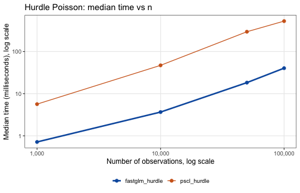

NB hurdle (with simultaneous `theta` MLE) on a single moderately large example:


``` r
set.seed(7)
n <- 1e4
x1 <- rnorm(n);  x2 <- rnorm(n)
lam <- exp(0.8 + 0.4 * x1 - 0.3 * x2)
is_pos <- rbinom(n, 1, plogis(-0.4 + 0.5 * x1))
yt <- integer(n)
for (i in seq_len(n)) {
    repeat {
        v <- MASS::rnegbin(1, mu = lam[i], theta = 1.5)
        if (v > 0) { yt[i] <- v; break }
    }
}
y  <- ifelse(is_pos == 1, yt, 0L)
df <- data.frame(y = y, x1 = x1, x2 = x2)

mb_hurdle_nb <- microbenchmark(
    fastglm_hurdle = fastglm_hurdle(y ~ x1 + x2, data = df, dist = "negbin"),
    pscl_hurdle    = pscl::hurdle (y ~ x1 + x2, data = df, dist = "negbin"),
    times = 3L
)
.fmt_table(mb_hurdle_nb)
```


|expr           | min (ms)| median (ms)| mean (ms)| max (ms)|
|:--------------|--------:|-----------:|---------:|--------:|
|fastglm_hurdle |    33.15|       36.19|     35.90|    38.37|
|pscl_hurdle    |    50.62|       50.80|     56.37|    67.69|


# Zero-inflated models

Zero-inflated Poisson against `pscl::zeroinfl()` across sample sizes:


``` r
set.seed(8)
run_one_zi <- function(n) {
    x1 <- rnorm(n);  x2 <- rnorm(n)
    eta_c <- 0.7 + 0.4 * x1 - 0.3 * x2
    eta_z <- -0.4 + 0.5 * x1 + 0.2 * x2
    z     <- rbinom(n, 1, plogis(eta_z))
    y     <- ifelse(z == 1, 0L, rpois(n, exp(eta_c)))
    df    <- data.frame(y = y, x1 = x1, x2 = x2)
    microbenchmark(
        fastglm_zi = fastglm_zi(y ~ x1 + x2, data = df, dist = "poisson"),
        pscl_zi    = pscl::zeroinfl(y ~ x1 + x2, data = df, dist = "poisson"),
        times = 5L
    )
}

zi_tim <- list()
for (n in c(1e3, 1e4, 5e4, 1e5)) {
    mb <- run_one_zi(n)
    zi_tim[[length(zi_tim) + 1]] <- .collect(mb, n)
}
zi_tim <- do.call(rbind, zi_tim)
.timing_table(zi_tim)
```


Table: Median time in milliseconds

|Method     | n = 1,000| n = 10,000| n = 50,000| n = 100,000|
|:----------|---------:|----------:|----------:|-----------:|
|fastglm_zi |      2.58|      28.20|     126.39|      249.66|
|pscl_zi    |      9.26|     111.97|     578.99|     1165.21|


``` r
.plot_scaling(zi_tim, "Zero-inflated Poisson: median time vs n")
```

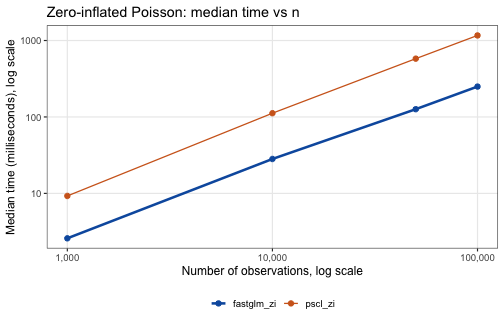

Zero-inflated NB on a single moderately large example:


``` r
set.seed(9)
n  <- 1e4
x1 <- rnorm(n);  x2 <- rnorm(n)
eta_c <- 0.8 + 0.4 * x1 - 0.3 * x2; lam <- exp(eta_c)
eta_z <- -0.4 + 0.5 * x1 + 0.2 * x2
z <- rbinom(n, 1, plogis(eta_z))
y <- ifelse(z == 1, 0L, MASS::rnegbin(n, mu = lam, theta = 2.0))
df <- data.frame(y = y, x1 = x1, x2 = x2)

mb_zi_nb <- microbenchmark(
    fastglm_zi = fastglm_zi(y ~ x1 + x2, data = df, dist = "negbin",
                            em.tol = 1e-8, em.maxit = 200L),
    pscl_zi    = pscl::zeroinfl(y ~ x1 + x2, data = df, dist = "negbin"),
    times = 3L
)
.fmt_table(mb_zi_nb)
```


|expr       | min (ms)| median (ms)| mean (ms)| max (ms)|
|:----------|--------:|-----------:|---------:|--------:|
|fastglm_zi |    73.53|       77.08|     76.37|    78.49|
|pscl_zi    |   149.64|      162.52|    158.52|   163.39|


# Summary

A compact summary of the speed advantage *fastglm* delivers, expressed as the ratio of reference-implementation median time to *fastglm* median time. Larger is better. The reference for each model class is the canonical R implementation; for the standard GLMs we report the ratio against the fastest among `glm.fit`, `glm2`, and `speedglm` so the comparison is conservative.


``` r
.speedup <- function(df, fast_label, ref_labels) {
    out <- lapply(split(df, df$n), function(sub) {
        fast <- sub$median[sub$expr == fast_label]
        if (length(fast) == 0) return(NULL)
        ref  <- min(sub$median[sub$expr %in% ref_labels])
        data.frame(n = sub$n[1], speedup = ref / fast)
    })
    do.call(rbind, out)
}

su_logit  <- .speedup(logit_tim,  "fastglm_chol",
                      c("glm.fit", "glm2_fit2", "speedglm"))
su_pois   <- .speedup(pois_tim,   "fastglm_chol",
                      c("glm.fit", "glm2_fit2", "speedglm"))
su_nb     <- .speedup(nb_tim,     "fastglm_nb",     "glm.nb")
firth_avg_tim <- aggregate(median ~ n + expr, data = firth_scale_tim, FUN = mean)
su_firth  <- .speedup(firth_avg_tim, "fastglm",  "brglm2")
su_hurdle <- .speedup(hurdle_tim, "fastglm_hurdle", "pscl_hurdle")
su_zi     <- .speedup(zi_tim,     "fastglm_zi",     "pscl_zi")

su_all <- rbind(
    transform(su_logit,  model = "logit"),
    transform(su_pois,   model = "poisson"),
    transform(su_nb,     model = "neg-binomial"),
    transform(su_firth,  model = "Firth (avg)"),
    transform(su_hurdle, model = "hurdle"),
    transform(su_zi,     model = "zero-inflated")
)

su_all$model <- factor(su_all$model, levels = unique(su_all$model))
ggplot(su_all, aes(n, speedup, colour = model, shape = model, group = model)) +
    geom_hline(yintercept = 1, linetype = 2, colour = "grey60") +
    geom_line(linewidth = 0.8) + geom_point(size = 2.4) +
    .size_axis() + scale_y_log10() +
    scale_colour_manual(values = c("#0B5CAD", "#D1661F", "#1F9E8F", "#9A62C4", "#9C8200", "#D0628E")) +
    labs(x = "Number of observations, log scale",
         y = "Reference time / fastglm time, log scale",
         title = "fastglm time ratio against each reference, by model class",
         colour = NULL, shape = NULL) +
    .benchmark_theme()
```

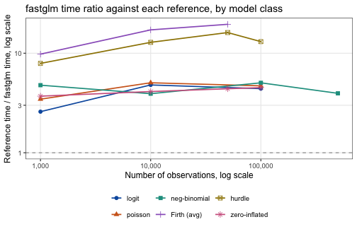

Speed advantages depend on the design, so these comparisons do not establish a uniform speed or convergence advantage. Any timing comparison should first check coefficients, fitted means, uncertainty calculations, and convergence.

# Ordinal models

These comparisons use packages that fit the same cumulative-link models. Each design has 10 predictors, and each time includes coefficient covariance. A time is compared only when that fit converged and agreed with *fastglm* on the log likelihood and common slopes.


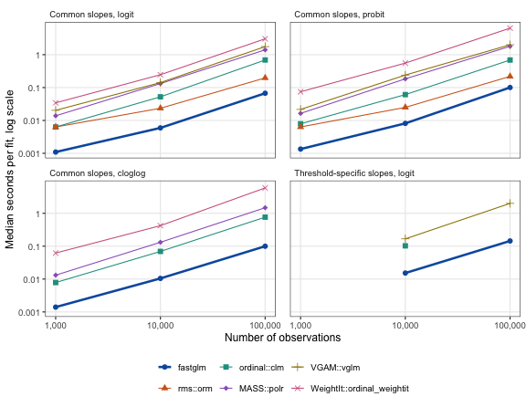


|Link    |Method                       | Seconds| Time ratio|
|:-------|:----------------------------|-------:|----------:|
|logit   |`fastglm`                    |   0.067|        1.0|
|logit   |`rms::orm`                   |   0.196|        2.9|
|logit   |`ordinal::clm`               |   0.695|       10.3|
|logit   |`MASS::polr`                 |   1.392|       20.7|
|logit   |`VGAM::vglm`                 |   1.783|       26.5|
|logit   |`WeightIt::ordinal_weightit` |   3.021|       44.9|
|probit  |`fastglm`                    |   0.100|        1.0|
|probit  |`rms::orm`                   |   0.219|        2.2|
|probit  |`ordinal::clm`               |   0.688|        6.9|
|probit  |`MASS::polr`                 |   1.794|       17.9|
|probit  |`VGAM::vglm`                 |   1.920|       19.2|
|probit  |`WeightIt::ordinal_weightit` |   6.300|       62.9|
|cloglog |`fastglm`                    |   0.098|        1.0|
|cloglog |`ordinal::clm`               |   0.747|        7.6|
|cloglog |`MASS::polr`                 |   1.403|       14.3|
|cloglog |`VGAM::vglm`                 |   6.508|         NA|
|cloglog |`WeightIt::ordinal_weightit` |   5.783|       58.8|


The table shows 100,000 observations and 5 categories. The ratio is the comparison time divided by the *fastglm* time. `rms::orm` was timed for logit and probit only. For cloglog, `VGAM::vglm` warned about intersecting predictors and returned a different fit, so it has no ratio.

The threshold-specific panel has no comparison at 1,000 observations, because the *fastglm* fit reported nonconvergence for that design: the best fit with ordered cumulative probabilities at every row lies on the ordering boundary. `ordinal::clm` reported convergence with a higher log likelihood, but its cumulative predictors cross at 3 of the 1,000 rows. At 100,000 observations, `ordinal::clm` reported that it had not converged, so it is omitted there as well.

With 20,000 observations, `rms::orm` overtakes *fastglm* between 30 and 300 categories:

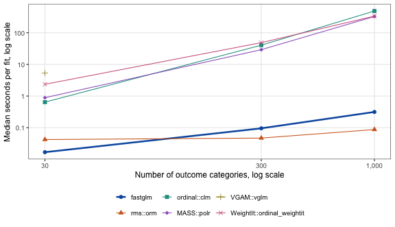


| Categories|Method                       | Seconds| Time ratio|
|----------:|:----------------------------|-------:|----------:|
|         30|`fastglm`                    |   0.017|       1.00|
|         30|`rms::orm`                   |   0.042|       2.51|
|         30|`ordinal::clm`               |   0.643|      38.02|
|         30|`MASS::polr`                 |   0.888|      52.56|
|         30|`VGAM::vglm`                 |   5.331|     315.44|
|         30|`WeightIt::ordinal_weightit` |   2.352|     139.15|
|        300|`fastglm`                    |   0.096|       1.00|
|        300|`rms::orm`                   |   0.047|       0.49|
|        300|`ordinal::clm`               |  40.457|     421.96|
|        300|`MASS::polr`                 |  29.138|     303.90|
|        300|`WeightIt::ordinal_weightit` |  48.617|     507.07|
|       1000|`fastglm`                    |   0.315|       1.00|
|       1000|`rms::orm`                   |   0.088|       0.28|
|       1000|`ordinal::clm`               | 484.423|    1537.47|
|       1000|`MASS::polr`                 | 325.835|    1034.14|
|       1000|`WeightIt::ordinal_weightit` | 334.278|    1060.94|


`rms::orm` is designed for outcomes with very many distinct values and is the faster choice in that range. `VGAM::vglm` was not run above 30 categories because it would need about 160 GB of memory at 1,000.

None of these packages fits mean bias-reduced cumulative-link models or reads ordinal data in blocks:

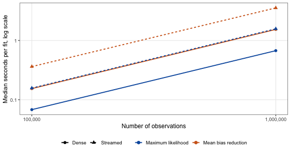


|Observations |Fit                          | Seconds| Largest coefficient difference from dense fit|
|:------------|:----------------------------|-------:|---------------------------------------------:|
|100,000      |Dense ML                     |   0.066|                                       0.0e+00|
|100,000      |Dense mean bias reduction    |   0.155|                                       0.0e+00|
|100,000      |Streamed ML                  |   0.154|                                       2.2e-16|
|100,000      |Streamed mean bias reduction |   0.369|                                       1.1e-16|
|1,000,000    |Dense ML                     |   0.671|                                       0.0e+00|
|1,000,000    |Dense mean bias reduction    |   1.533|                                       0.0e+00|
|1,000,000    |Streamed ML                  |   1.596|                                       1.1e-16|
|1,000,000    |Streamed mean bias reduction |   3.573|                                       3.0e-17|


Streamed fits use blocks of 10,000 rows. The last column compares each streamed fit with the dense fit of the same estimator.

# References

- Enea, M. (2009). Fitting linear models and generalized linear models with large data sets in R. In *Statistical Methods for the Analysis of Large Data-sets*, Italian Statistical Society. *speedglm* package documentation.

- Firth, D. (1993). Bias reduction of maximum likelihood estimates. *Biometrika*, 80(1), 27&ndash;38. <doi:10.1093/biomet/80.1.27>

- Heinze, G. and Schemper, M. (2002). A solution to the problem of separation in logistic regression. *Statistics in Medicine*, 21(16), 2409&ndash;2419. <doi:10.1002/sim.1047>

- Kosmidis, I. and Firth, D. (2009). Bias reduction in exponential family nonlinear models. *Biometrika*, 96(4), 793&ndash;804. <doi:10.1093/biomet/asp055>

- Marschner, I. C. (2011). glm2: Fitting generalized linear models with convergence problems. *The R Journal*, 3(2), 12&ndash;15. <doi:10.32614/RJ-2011-012>

- Venables, W. N. and Ripley, B. D. (2002). *Modern Applied Statistics with S* (4th ed.). Springer.

- Zeileis, A., Kleiber, C., and Jackman, S. (2008). Regression models for count data in R. *Journal of Statistical Software*, 27(8), 1&ndash;25. <doi:10.18637/jss.v027.i08>
