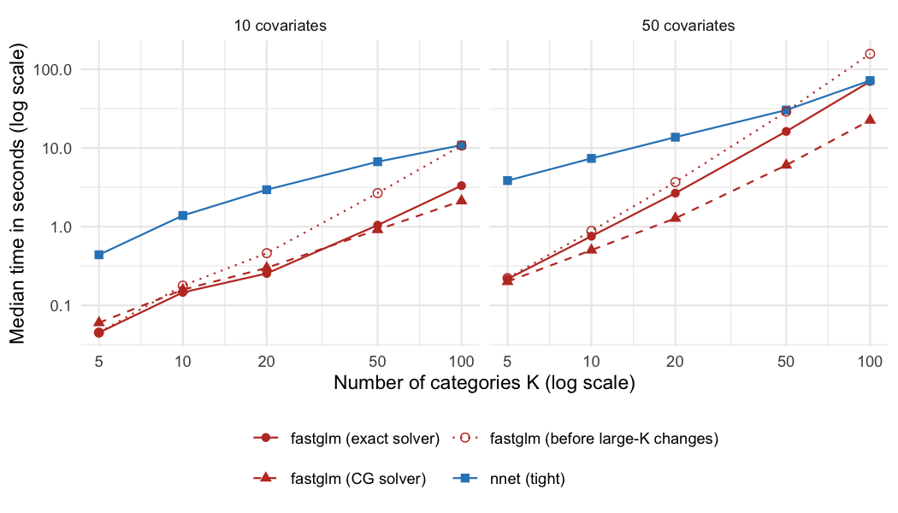

`fastglm_multinom()` fits multinomial (baseline-category) logit models by Fisher scoring with the step-halving safeguards of `fastglm()`. Fits support model-based, robust, and cluster-robust covariance, Wald tests, probability averages and marginal effects with standard errors, the bootstrap, and mean bias reduction, and the same function fits sparse, memory-mapped, and streamed data. This vignette works through an example and then reports timing comparisons with `nnet::multinom()` and `VGAM::vglm()`.

# Multinomial functionality at a glance {#multinom-scope}

| Analysis task | Functions | Notes |
|:--|:--|:--|
| Fit the model | `fastglm_multinom()` | Formula, dense matrix, `dgCMatrix`, `big.matrix`, or `fastglm_source()`; factor response or a matrix of category counts; weights and offsets; `firth = TRUE` for mean bias reduction |
| Display and extract estimates | `print()`, `summary()`, `coef(matrix = TRUE)`, `vcov()`, `confint()`, `logLik()`, `AIC()`, `BIC()`, `nobs()`, `broom::tidy()`, `broom::glance()` | Coefficients are named `"<category>:<term>"` |
| Predict | `predict()` with `type = "probability"`, `"class"`, or `"link"`, optionally with `se.fit = TRUE` | Standard errors by the delta method |
| Robust inference | `fastglm_vcov()`, `fastglm_wald_test()`, `fastglm_bootstrap()` | HC0 and HC1 sandwich and cluster-robust covariance; pairs and cluster bootstrap |
| Probability summaries | `fastglm_average()`, `fastglm_marginal_effects()` | Average probabilities, contrasts, and average derivatives for every category |
| Diagnostics | `fastglm_diagnostics()`, `residuals()` | Score size, conditioning, and the separation flag |

# Model and parameterization {#multinom-model}

For observations $i = 1, \dots, n$ with design rows $x_i$ of length $p$ (including the intercept), response categories $1, \dots, K$, and reference category $r$, the model has one linear predictor for each non-reference category,
$$
\eta_{ik} = \log \frac{\pi_{ik}}{\pi_{ir}} = o_{ik} + x_i^\top \beta_k, \qquad k \neq r,
$$
with $\pi_{ik} = \Pr(Y_i = k \mid x_i)$ and offsets $o_{ik}$, so that
$$
\pi_{ik} = \frac{\exp(\eta_{ik})}{1 + \sum_{l \neq r} \exp(\eta_{il})}, \qquad
\pi_{ir} = \frac{1}{1 + \sum_{l \neq r} \exp(\eta_{il})}.
$$
The coefficient $\beta_{kj}$ is the change in the log odds of category $k$ relative to category $r$ per unit change in covariate $j$. There are $P = p(K - 1)$ coefficients. The reference is the first level of the response by default, as in `nnet::multinom()`, and `reference` selects another level; the fitted probabilities and the likelihood do not depend on this choice.

With prior weights $w_i$, category counts $y_{ik}$, and totals $m_i = \sum_{k=1}^K y_{ik}$ (for individual data, $y_{ik}$ indicates $Y_i = k$ and $m_i = 1$), the log likelihood is $\ell(\beta) = \sum_i w_i \sum_k y_{ik} \log \pi_{ik}$. Writing $\pi_i$ and $y_i$ for the vectors of $\pi_{ik}$ and $y_{ik}$ over the $K - 1$ non-reference categories, $I_{K-1}$ for the identity matrix, and $X_i = I_{K-1} \otimes x_i^\top$ (so that $(\eta_{ik})_{k \neq r} = X_i \beta$ without offsets, with $\beta = (\beta_k)_{k \neq r}$ stacked), the score and the expected (Fisher) information are
$$
U(\beta) = \sum_i w_i X_i^\top (y_i - m_i \pi_i), \qquad
F(\beta) = \sum_i X_i^\top W_i X_i, \qquad
W_i = w_i m_i \{\operatorname{diag}(\pi_i) - \pi_i \pi_i^\top\}.
$$
Each Fisher scoring step is $\beta \leftarrow \beta + \alpha\, F(\beta)^{-1} U(\beta)$, starting from $\alpha = 1$ and halving $\alpha$ until the log likelihood does not decrease. With the deviance $D(\beta) = -2\ell(\beta)$ for individual data (grouped data are treated [below](#multinom-grouped)), the iteration stops when the deviance $D$ of the new iterate and $D_{\text{old}}$ of the previous one satisfy $|D - D_{\text{old}}| / (0.1 + |D|) < \varepsilon$ with $\varepsilon$ = `tol` and the Fisher decrement confirms it, $U^\top F^{-1} U / (0.1 + |D|) < \varepsilon$ at the new iterate. The estimate $\hat\beta$ is that iterate, and $\hat\pi_{ik}$ and $\hat\eta_{ik}$ are evaluated at it; a fit reported as converged is at the maximum of the likelihood to the tolerance `tol`.

# Example data {#multinom-data}

The examples use simulated data on the commuting mode (car, transit, bike, walk) of 3,000 workers in 30 cities, with distance in kilometers, age, and income group as covariates. A city-level shift shared by the non-car linear predictors makes responses within a city correlated.


``` r
set.seed(2026)
n <- 3000
city <- factor(sample(sprintf("city%02d", 1:30), n, replace = TRUE))
distance <- round(pmin(rlnorm(n, log(6), 0.6), 30), 1)
age <- round(runif(n, 18, 75))
income <- factor(sample(c("low", "middle", "high"), n, replace = TRUE,
                        prob = c(0.30, 0.45, 0.25)),
                 levels = c("low", "middle", "high"))
shift <- rnorm(30, sd = 0.4)[city]
eta <- cbind(car     = 0,
             transit = 0.8 - 0.05 * distance - 0.01 * (age - 40) -
                       0.5 * (income == "high") + shift,
             bike    = 1.2 - 0.35 * distance - 0.03 * (age - 40) -
                       0.2 * (income == "high") + shift,
             walk    = 3.0 - 1.10 * distance - 0.01 * (age - 40) + shift)
prob <- exp(eta) / rowSums(exp(eta))
mode <- apply(prob, 1, function(p) sample(colnames(eta), 1, prob = p))
commute <- data.frame(mode = factor(mode, levels = colnames(eta)),
                      distance, age, income, city)
table(commute$mode)
#> 
#>     car transit    bike    walk 
#>    1100    1386     355     159
```

# Fitting and printed output {#multinom-fit}

The formula interface follows `glm()`. The response is a factor, and its first level, `car`, is the reference.


``` r
fit <- fastglm_multinom(mode ~ distance + age + income, data = commute)
fit
#> Multinomial logit regression
#> 
#> Call:
#> fastglm_multinom(formula = mode ~ distance + age + income, data = commute)
#> Estimation: maximum likelihood
#> Reference category: car
#> 
#> Coefficients (rows: non-reference categories):
#>         (Intercept)  distance       age incomemiddle incomehigh
#> transit    1.148269 -0.037732 -0.010198    -0.068570  -0.457753
#> bike       2.082070 -0.317950 -0.028452    -0.032199  -0.076060
#> walk       2.582374 -1.012633  0.000729    -0.226048  -0.129513
#> 
#> Residual deviance: 6141 on 8985 degrees of freedom
#> Convergence: converged (7 iterations)
```

The printed coefficients are the matrix $(\beta_k)_{k \neq r}$, one row per non-reference category, as returned by `coef(fit, matrix = TRUE)`. Row `walk` gives the log odds of walking relative to driving, which decrease by about 1 per kilometer. The residual degrees of freedom are $n(K - 1)$ minus the number of estimated coefficients (the rank; coefficients of aliased design columns are not estimated), as in `VGAM::vglm()`, and the last line gives the convergence status and the number of Fisher scoring iterations.

`summary()` gives Wald tests $z = \hat\beta_{kj} / \widehat{\operatorname{se}}(\hat\beta_{kj})$ with standard errors from $F(\hat\beta)^{-1}$. Coefficients are named `<category>:<term>`.


``` r
summary(fit)
#> Multinomial logit regression
#> 
#> Call:
#> fastglm_multinom(formula = mode ~ distance + age + income, data = commute)
#> Estimation: maximum likelihood
#> Reference category: car
#> 
#> Coefficients:
#>                       Estimate Std. Error z value Pr(>|z|)    
#> transit:(Intercept)   1.148269   0.160401   7.159   <1e-04 ***
#> bike:(Intercept)      2.082070   0.256492   8.117   <1e-04 ***
#> walk:(Intercept)      2.582374   0.397462   6.497   <1e-04 ***
#> transit:distance     -0.037732   0.008976  -4.204   <1e-04 ***
#> bike:distance        -0.317950   0.025945 -12.255   <1e-04 ***
#> walk:distance        -1.012633   0.074606 -13.573   <1e-04 ***
#> transit:age          -0.010198   0.002482  -4.109   <1e-04 ***
#> bike:age             -0.028452   0.003976  -7.156   <1e-04 ***
#> walk:age              0.000729   0.005732   0.127    0.899    
#> transit:incomemiddle -0.068570   0.097263  -0.705    0.481    
#> bike:incomemiddle    -0.032199   0.155619  -0.207    0.836    
#> walk:incomemiddle    -0.226048   0.222868  -1.014    0.310    
#> transit:incomehigh   -0.457753   0.110859  -4.129   <1e-04 ***
#> bike:incomehigh      -0.076060   0.172388  -0.441    0.659    
#> walk:incomehigh      -0.129513   0.244756  -0.529    0.597    
#> ---
#> Signif. codes:  0 '***' 0.001 '**' 0.01 '*' 0.05 '.' 0.1 ' ' 1
#> 
#> Null deviance:     6797
#> Residual deviance: 6141 on 8985 degrees of freedom
#> Log likelihood: -3070 (15 parameters, 3000 observations)
#> AIC: 6171  BIC: 6261
#> Convergence: converged (7 iterations)
```

Coefficients are ordered term by term: all categories of the intercept, then all categories of `distance`, and so on. The residual deviance is $D(\hat\beta) = -2\ell(\hat\beta)$ for individual data, the null deviance is that of the intercept-only model, and AIC and BIC count the $15$ coefficients. The usual extractors return the coefficients, $F(\hat\beta)^{-1}$, Wald intervals, and the log likelihood.


``` r
coef(fit)[1:4]
#> transit:(Intercept)    bike:(Intercept)    walk:(Intercept)    transit:distance 
#>           1.1482686           2.0820702           2.5823740          -0.0377319
round(vcov(fit)[1:3, 1:3], 5)
#>                     transit:(Intercept) bike:(Intercept) walk:(Intercept)
#> transit:(Intercept)             0.02573          0.01629          0.01641
#> bike:(Intercept)                0.01629          0.06579          0.02719
#> walk:(Intercept)                0.01641          0.02719          0.15798
confint(fit)[c("transit:distance", "bike:distance", "walk:distance"), ]
#>                        2.5 %      97.5 %
#> transit:distance -0.05532484 -0.02013895
#> bike:distance    -0.36880016 -0.26709937
#> walk:distance    -1.15885884 -0.86640722
logLik(fit)
#> 'log Lik.' -3070.429 (df=15)
c(AIC = AIC(fit), BIC = BIC(fit), n = nobs(fit))
#>      AIC      BIC        n 
#> 6170.857 6260.953 3000.000
```

`broom::tidy()` and `broom::glance()` return data frames, with the category in `y.level` as for `nnet::multinom()`.


``` r
head(broom::tidy(fit, conf.int = TRUE), 4)
#>          term y.level   estimate   std.error statistic      p.value    conf.low
#> 1 (Intercept) transit  1.1482686 0.160400989  7.158738 8.142329e-13  0.83388845
#> 2 (Intercept)    bike  2.0820702 0.256492111  8.117482 4.759535e-16  1.57935492
#> 3 (Intercept)    walk  2.5823740 0.397461453  6.497168 8.184580e-11  1.80336388
#> 4    distance transit -0.0377319 0.008976158 -4.203569 2.627391e-05 -0.05532484
#>     conf.high
#> 1  1.46264878
#> 2  2.58478551
#> 3  3.36138414
#> 4 -0.02013895
broom::glance(fit)
#>   nobs df    logLik      AIC      BIC deviance null.deviance df.residual
#> 1 3000 15 -3070.429 6170.857 6260.953 6140.857      6797.207        8985
#>   converged
#> 1      TRUE
```

# Predicted probabilities {#multinom-predict}

`predict()` returns the $n \times K$ matrix of $\hat\pi_{ik}$; `type = "class"` returns $\arg\max_k \hat\pi_{ik}$ and `type = "link"` the $\hat\eta_{ik}$. With `se.fit = TRUE`, standard errors are $\{\nabla_\beta \pi_{ik}^\top\, \hat V\, \nabla_\beta \pi_{ik}\}^{1/2}$ (delta method) with $\hat V = F(\hat\beta)^{-1}$.


``` r
profiles <- data.frame(distance = c(2, 5, 15), age = 35,
                       income = factor("middle", levels(commute$income)))
predict(fit, newdata = profiles)
#>         car   transit       bike         walk
#> 1 0.1707081 0.3261202 0.25932749 2.438442e-01
#> 2 0.2976489 0.5077707 0.17419965 2.038074e-02
#> 3 0.4557655 0.5331352 0.01109804 1.248670e-06
predict(fit, newdata = profiles, type = "class")
#>       1       2       3 
#> transit transit transit 
#> Levels: car transit bike walk
predict(fit, newdata = profiles, se.fit = TRUE)$se.fit
#>          car    transit        bike         walk
#> 1 0.01351941 0.02102567 0.023002472 3.130005e-02
#> 2 0.01436453 0.01594619 0.013018054 4.252984e-03
#> 3 0.02277400 0.02275155 0.002976247 1.129063e-06
```


# Inference {#multinom-inference}

## Model-based and cluster-robust covariance

`fastglm_vcov()` computes the sandwich covariance
$$
\hat V_{\text{rob}} = F(\hat\beta)^{-1} \Big(\sum_g s_g s_g^\top\Big) F(\hat\beta)^{-1}, \qquad s_g = \sum_{i \in g} w_i X_i^\top (y_i - m_i \hat\pi_i),
$$
where $g$ indexes clusters given by `cluster` (multiplied by $G/(G - 1)$ for $G$ clusters by default) or single observations otherwise (`type = "HC0"`, or `"HC1"` with the factor $n/(n - P)$). Here the clusters are cities.


``` r
v_cluster <- fastglm_vcov(fit, cluster = commute$city)
se <- cbind(model = sqrt(diag(vcov(fit))), cluster = sqrt(diag(v_cluster)))
round(se[grep("income", rownames(se)), ], 4)
#>                       model cluster
#> transit:incomemiddle 0.0973  0.1095
#> bike:incomemiddle    0.1556  0.1438
#> walk:incomemiddle    0.2229  0.2460
#> transit:incomehigh   0.1109  0.1260
#> bike:incomehigh      0.1724  0.1865
#> walk:incomehigh      0.2448  0.3017
```

## Joint Wald tests

`fastglm_wald_test()` computes $T = (L\hat\beta)^\top (L \hat V L^\top)^{-1} (L\hat\beta)$, referred to $\chi^2_q$, where $L$ is the $q \times P$ matrix whose rows select the $q$ coefficients of a term and $\hat V$ is a covariance estimate of $\hat\beta$. Income has $2 \times 3 = 6$ coefficients. The test is shown with $\hat V = F(\hat\beta)^{-1}$ and then with the cluster-robust $\hat V_{\text{rob}}$.


``` r
fastglm_wald_test(fit, terms = "income")
#> Joint Wald test
#> Terms: income
#> Estimation: fitted model coefficients
#> Covariance: model-based
#> 
#>  Statistic df   p-value
#>      23.54  6 0.0006342
#> 
#> Tested contrasts:
#>                      Estimate Std. Error     Null
#> transit:incomemiddle -0.06857    0.09726  0.00000
#> bike:incomemiddle    -0.03220    0.15562  0.00000
#> walk:incomemiddle    -0.22605    0.22287  0.00000
#> transit:incomehigh   -0.45775    0.11086  0.00000
#> bike:incomehigh      -0.07606    0.17239  0.00000
#> walk:incomehigh      -0.12951    0.24476  0.00000
#> 
#> Note: First-order chi-square approximation; validity depends on coefficient
#>   estimability and the covariance assumptions.
fastglm_wald_test(fit, terms = "income", vcov. = v_cluster)$statistic
#> [1] 29.02604
```

## Likelihood ratio tests

The likelihood ratio statistic $2\{\ell(\hat\beta) - \ell(\hat\beta_0)\}$, with $\hat\beta_0$ the estimate under the smaller model, compares nested fits; here the smaller model drops income, so the statistic is referred to $\chi^2_6$.


``` r
fit0 <- fastglm_multinom(mode ~ distance + age, data = commute)
lr <- 2 * as.numeric(logLik(fit) - logLik(fit0))
c(statistic = lr, df = 6, p.value = pchisq(lr, 6, lower.tail = FALSE))
#>    statistic           df      p.value 
#> 2.385573e+01 6.000000e+00 5.551482e-04
```

## Bootstrap

`fastglm_bootstrap()` refits the model to resampled data; `type = "cluster"` resamples whole clusters. Failed or nonconverged refits are recorded, and if any refit fails, standard errors and intervals are returned as missing.


``` r
boot <- fastglm_bootstrap(fit, R = 199, type = "cluster",
                          cluster = commute$city, seed = 1)
boot
#> Refit bootstrap (cluster)
#> Refits: 199 of 199 successful
#> 
#> Estimates and confidence intervals:
#>                       Estimate Std. Error     lower     upper
#> transit:(Intercept)   1.148269   0.179217  0.814015  1.484923
#> bike:(Intercept)      2.082070   0.253008  1.537694  2.536878
#> walk:(Intercept)      2.582374   0.378525  1.951358  3.419093
#> transit:distance     -0.037732   0.007581 -0.053193 -0.022935
#> bike:distance        -0.317950   0.024195 -0.367281 -0.275080
#> walk:distance        -1.012633   0.067732 -1.161738 -0.902470
#> transit:age          -0.010198   0.002725 -0.015677 -0.005140
#> bike:age             -0.028452   0.003894 -0.036158 -0.021018
#> walk:age              0.000729   0.005807 -0.012154  0.009226
#> transit:incomemiddle -0.068570   0.113531 -0.252475  0.155070
#> bike:incomemiddle    -0.032199   0.139482 -0.273556  0.215558
#> walk:incomemiddle    -0.226048   0.232186 -0.621156  0.260444
#> transit:incomehigh   -0.457753   0.135609 -0.688954 -0.158033
#> bike:incomehigh      -0.076060   0.189770 -0.468183  0.266338
#> walk:incomehigh      -0.129513   0.325817 -0.701123  0.468703
```


# Probability summaries {#multinom-effects}

The sign of $\beta_{kj}$ need not match the direction in which $\pi_{ik}$ changes with $x_{ij}$, since every $\pi_{ik}$ depends on all $\eta_{il}$. `fastglm_average()` estimates $\bar\pi_k = n^{-1} \sum_i \hat\pi_{ik}$ with delta-method standard errors.


``` r
fastglm_average(fit)
#>   category  estimate   std.error   conf.low  conf.high
#> 1      car 0.3666667 0.008574640 0.34986068 0.38347265
#> 2  transit 0.4620000 0.008984842 0.44439003 0.47960997
#> 3     bike 0.1183333 0.005702300 0.10715703 0.12950964
#> 4     walk 0.0530000 0.003750647 0.04564887 0.06035113
```

Write $\pi_k(x)$ for the probability of category $k$ at design row $x$, so that $\pi_{ik} = \pi_k(x_i)$. With `contrast`, a function $c$ applied to the design rows, it estimates $n^{-1} \sum_i \{\pi_k(c(x_i)) - \pi_k(x_i)\}$. Below, $c$ sets every worker's income group to high.


``` r
to_high <- function(x) {
  x[, "incomemiddle"] <- 0
  x[, "incomehigh"] <- 1
  x
}
fastglm_average(fit, contrast = to_high)
#>   category     estimate   std.error     conf.low   conf.high
#> 1      car  0.054558707 0.014762642  0.025624460  0.08349295
#> 2  transit -0.072395847 0.015115782 -0.102022235 -0.04276946
#> 3     bike  0.011458436 0.010036012 -0.008211786  0.03112866
#> 4     walk  0.006378703 0.006654792 -0.006664449  0.01942185
```

`fastglm_marginal_effects()` estimates the average derivative $n^{-1} \sum_i \partial \pi_{ik} / \partial x_{ij}$. For a covariate entering linearly,
$$
\frac{\partial \pi_{ik}}{\partial x_{ij}} = \pi_{ik} \Big(\beta_{kj} - \sum_{l} \pi_{il} \beta_{lj}\Big), \qquad \beta_{rj} = 0,
$$
so the effects sum to zero over $k$.


``` r
me <- fastglm_marginal_effects(fit, "distance")
me
#>   variable category    estimate   std.error    conf.low   conf.high
#> 1 distance      car  0.03117248 0.001848661  0.02754917  0.03479579
#> 2 distance  transit  0.02641351 0.002280666  0.02194348  0.03088353
#> 3 distance     bike -0.01879048 0.002187983 -0.02307885 -0.01450211
#> 4 distance     walk -0.03879551 0.003204354 -0.04507593 -0.03251509
sum(me$estimate)
#> [1] 8.96852e-14
```

Both functions accept `vcov.`, for example $\hat V_{\text{rob}}$.

# Diagnostics {#multinom-diagnostics}

`fastglm_diagnostics()` reports the convergence status, the number of estimable coefficients, the standardized score at $\hat\beta$, and the condition number of $F(\hat\beta)^{-1}$. `residuals()` returns $n \times K$ matrices of response residuals $y_{ik} - \hat\pi_{ik}$ or Pearson residuals $\sqrt{w_i}\,(y_{ik} - \hat\pi_{ik}) / \{\hat\pi_{ik}(1 - \hat\pi_{ik})\}^{1/2}$.


``` r
fastglm_diagnostics(fit)
#> Numerical diagnostics
#> Convergence: converged (7 iterations)
#> Estimable coefficients (rank): 15
#> Boundary flag: no
#> 
#>                        Check     Value
#>  Standardized ordinary score 1.382e-09
#>  Covariance condition number    354448
head(residuals(fit, type = "pearson"), 3)
#>          car    transit       bike        walk
#> 1 -0.7492676  1.0050623 -0.3414293 -0.20029734
#> 2 -0.7953958  0.9790846 -0.3165822 -0.10467463
#> 3 -0.9359699 -0.8877318  3.1958898 -0.05598151
```

# Grouped data and offsets {#multinom-grouped}

A response given as a matrix of category counts $y_{ik}$ (one column per category, through `cbind()` or a matrix column) is fitted with $m_i = \sum_k y_{ik}$ in the likelihood above, so it gives the same estimates as the individual records. For grouped data the deviance is $D = 2\{\ell_{\text{sat}} - \ell(\hat\beta)\}$ with $\ell_{\text{sat}} = \sum_i w_i \sum_k y_{ik} \log(y_{ik}/m_i)$, as `glm()` does for a grouped binomial response.


``` r
commute$age_group <- cut(commute$age, c(17, 35, 55, 75))
counts <- as.data.frame.matrix(table(interaction(commute$income, commute$age_group,
                                                 sep = "_"), commute$mode))
groups <- do.call(rbind, strsplit(rownames(counts), "_"))
grouped <- data.frame(income = factor(groups[, 1], levels(commute$income)),
                      age_group = factor(groups[, 2], levels(commute$age_group)))
grouped$y <- as.matrix(counts)
fit_g <- fastglm_multinom(y ~ income + age_group, data = grouped)
fit_i <- fastglm_multinom(mode ~ income + age_group, data = commute)
max(abs(coef(fit_g) - coef(fit_i)))
#> [1] 1.554312e-15
c(grouped = deviance(fit_g), df = fit_g$df.residual)
#>  grouped       df 
#> 11.43809 12.00000
```

The deviance of 11.4 on 12 degrees of freedom shows no lack of fit of the grouped model.

`offset` is a vector (the same $o_{ik}$ for all $k$) or an $n \times (K - 1)$ matrix of $o_{ik}$, one column per non-reference category in level order.

# Separation and bias reduction {#multinom-firth}

Under separation the likelihood has no finite maximum and some $\hat\beta_{kj}$ diverge. In `iris`, petal measurements separate *setosa* from the other species. The fit warns when fitted probabilities are numerically 0 or 1 (the threshold of `glm.fit()`), sets `separation = TRUE`, and notes in `summary()` that the Wald standard errors are unreliable.


``` r
fit_iris <- fastglm_multinom(Species ~ Petal.Length + Petal.Width, data = iris)
#> Warning: fastglm: fitted probabilities numerically 0 or 1 occurred; consider
#> firth = TRUE
fit_iris$separation
#> [1] TRUE
coef(fit_iris, matrix = TRUE)
#>            (Intercept) Petal.Length Petal.Width
#> versicolor   -62.41464     16.63440    28.20114
#> virginica   -107.68699     22.38893    38.64784
```

With `firth = TRUE`, the estimate solves the adjusted score equations of Firth (1993); for the multinomial logit, a canonical-link model, this is the maximizer of $\ell(\beta) + \tfrac12 \log\det F(\beta)$, which is finite under separation (Kosmidis and Firth, 2011). The estimates agree with `brglm2::brmultinom(type = "AS_mean")` to the convergence tolerance.


``` r
fit_firth <- fastglm_multinom(Species ~ Petal.Length + Petal.Width, data = iris,
                              firth = TRUE)
summary(fit_firth)
#> Multinomial logit regression
#> 
#> Call:
#> fastglm_multinom(formula = Species ~ Petal.Length + Petal.Width, 
#>     data = iris, firth = TRUE)
#> Estimation: mean bias reduction
#> Reference category: setosa
#> 
#> Coefficients:
#>                         Estimate Std. Error z value Pr(>|z|)    
#> versicolor:(Intercept)    -7.994      2.496  -3.203  0.00136 ** 
#> virginica:(Intercept)    -44.158     10.196  -4.331  < 1e-04 ***
#> versicolor:Petal.Length    1.556      2.423   0.642  0.52071    
#> virginica:Petal.Length     5.988      3.004   1.993  0.04624 *  
#> versicolor:Petal.Width     5.148      6.594   0.781  0.43500    
#> virginica:Petal.Width     13.964      7.262   1.923  0.05448 .  
#> ---
#> Signif. codes:  0 '***' 0.001 '**' 0.01 '*' 0.05 '.' 0.1 ' ' 1
#> 
#> Null deviance:     329.6
#> Residual deviance: 24.14 on 294 degrees of freedom
#> Log likelihood: -12.07 (6 parameters, 150 observations)
#> AIC: 36.14  BIC: 54.21
#> Convergence: converged (22 iterations)
```

Near separation the bias-reduced iteration converges linearly, so a smaller `tol` (for example `1e-12`) gives tighter agreement with other software.

# Large data and many categories {#multinom-large}

The design can also be a sparse `Matrix::dgCMatrix`, a memory-mapped `bigmemory::big.matrix` read in blocks, or a `fastglm_source()` (including `fastglm_source_dbi()` and `fastglm_source_arrow()`) that supplies blocks of rows, so the data are never held in memory at once. These are described in the [large-data vignette](large-data-fastglm.html) and work as in `fastglm()`.


``` r
x <- Matrix::sparse.model.matrix(~ distance + age + income, data = commute)
fit_sparse <- fastglm_multinom(x, commute$mode)
max(abs(coef(fit_sparse) - coef(fit)))
#> [1] 3.108624e-15
```

Forming $F(\beta)$ costs $O(n p^2 K^2)$ operations per step and solving the step $O(P^3)$, so large $K$ dominates the cost. Two parts of the computation address this.

* The weight $W_i = w_i m_i \operatorname{diag}(\pi_i) - (\sqrt{w_i m_i}\, \pi_i)(\sqrt{w_i m_i}\, \pi_i)^\top$ is diagonal minus rank one. Let $X$ be the $n \times p$ design matrix with rows $x_i^\top$ and $\Lambda_k = \operatorname{diag}(w_1 m_1 \pi_{1k}, \dots, w_n m_n \pi_{nk})$. When $K - 1 \geq 6$, $F$ is accumulated as the $K - 1$ diagonal blocks $X^\top \Lambda_k X$ minus one symmetric rank update $Z^\top Z$, where row $i$ of the $n \times P$ matrix $Z$ is $\sqrt{w_i m_i}\,(\pi_i \otimes x_i)^\top$, in place of $K(K - 1)/2$ separate weighted cross products.
* The truncated Newton solver (`control = list(solver = "cg")`) computes the step $\delta = F^{-1} U$ approximately, by preconditioned conjugate gradients on $F\delta = U$. These use only products $F v = \sum_i X_i^\top W_i (X_i v)$ for vectors $v$ of length $P$, each costing $O(npK)$ and needing no $P \times P$ matrix; the preconditioner is the block-diagonal part of $F$ over categories. Convergence is confirmed with the full $F$, as for the exact solver, so the two solvers agree to the convergence tolerance.

`solver = "auto"` (the default) uses the conjugate gradient solver when the number of design columns satisfies $p \geq 8$ and $p(K - 1) \geq 400$, and the exact solver otherwise; the choice is stored in `fit$solver`.


``` r
fit_cg <- fastglm_multinom(mode ~ distance + age + income, data = commute,
                           control = list(solver = "cg"), tol = 1e-12)
fit_ex <- fastglm_multinom(mode ~ distance + age + income, data = commute,
                           control = list(solver = "exact"), tol = 1e-12)
c(fit_cg$solver, fit_ex$solver, fit$solver)
#> [1] "cg"    "exact" "exact"
max(abs(coef(fit_cg) - coef(fit_ex)))
#> [1] 1.776357e-15
```

# Speed and accuracy {#multinom-speed}


Timings are medians of five runs, each fit in its own R process with single-threaded linear algebra, for `fastglm_multinom()` 0.1.5 on an Apple silicon Mac (R version 4.5.1 (2025-06-13)). The machine was shared with other jobs (load average 5 to 6 on 14 cores), so absolute times carry some noise. Data were simulated from multinomial logit models with standard normal covariates.

## Comparison with nnet and VGAM

Three settings with few categories. `nnet::multinom()` was run at its defaults and with `maxit = 10000`, `reltol = abstol = 1e-14` (tight), and `VGAM::vglm()` with `epsilon = 1e-12`. The last column is $(\ell_{\text{best}} - \ell)/|\ell_{\text{best}}|$, where $\ell_{\text{best}}$ is the largest log likelihood found by any method.


|Setting                           |Method          | Time (s)| Relative to fastglm| Log-likelihood gap|
|:---------------------------------|:---------------|--------:|-------------------:|------------------:|
|n =  20,000, 20 covariates, K = 4 |fastglm         |     0.09|                 1.0|            < 1e-12|
|n =  20,000, 20 covariates, K = 4 |nnet (defaults) |     0.72|                 8.3|            1.7e-07|
|n =  20,000, 20 covariates, K = 4 |nnet (tight)    |     0.75|                 8.6|            < 1e-12|
|n =  20,000, 20 covariates, K = 4 |VGAM            |     1.27|                14.6|            < 1e-12|
|n =  20,000, 60 covariates, K = 6 |fastglm         |     0.30|                 1.0|            < 1e-12|
|n =  20,000, 60 covariates, K = 6 |nnet (defaults) |     2.65|                 8.9|            9.0e-09|
|n =  20,000, 60 covariates, K = 6 |nnet (tight)    |     6.00|                20.1|            < 1e-12|
|n =  20,000, 60 covariates, K = 6 |VGAM            |    29.34|                98.1|            < 1e-12|
|n = 100,000, 40 covariates, K = 5 |fastglm         |     0.86|                 1.0|            < 1e-12|
|n = 100,000, 40 covariates, K = 5 |nnet (defaults) |     5.84|                 6.8|            1.4e-08|
|n = 100,000, 40 covariates, K = 5 |nnet (tight)    |    15.73|                18.3|            < 1e-12|
|n = 100,000, 40 covariates, K = 5 |VGAM            |    37.61|                43.7|            < 1e-12|


`nnet::multinom()` took 7 to 9 times as long at its defaults and 9 to 20 times as long with tight tolerances, the setting in which it reaches the same maximum. Its defaults stop BFGS at a relative change in the objective of $10^{-8}$ or after 100 iterations, slightly below the maximum here. `VGAM::vglm()` reached the maximum and took 15 to 98 times as long.

## Many categories

$K$ from 5 to 100 with $n = 20{,}000$ and 10 or 50 covariates plus an intercept (up to $P = 5{,}049$), comparing the exact and conjugate gradient solvers, `fastglm_multinom()` before the large-$K$ changes in this release, and `nnet::multinom()` with tight tolerances. All methods reached the same log likelihood, with relative differences below $10^{-12}$.

<div class="figure">

<p class="caption">plot of chunk speed-part3</p>
</div>


Table: Median time in seconds for n = 20,000 observations.

| Covariates|   K| Coefficients| Exact|    CG| Before| nnet (tight)|
|----------:|---:|------------:|-----:|-----:|------:|------------:|
|         10|   5|           44|  0.04|  0.06|   0.04|         0.44|
|         10|  10|           99|  0.15|  0.16|   0.18|         1.39|
|         10|  20|          209|  0.25|  0.30|   0.46|         2.94|
|         10|  50|          539|  1.04|  0.91|   2.67|         6.68|
|         10| 100|         1089|  3.32|  2.12|  10.74|        10.86|
|         50|   5|          204|  0.22|  0.20|   0.22|         3.85|
|         50|  10|          459|  0.76|  0.50|   0.88|         7.37|
|         50|  20|          969|  2.66|  1.27|   3.68|        13.71|
|         50|  50|         2499| 16.22|  6.04|  28.93|        30.30|
|         50| 100|         5049| 70.02| 22.49| 157.08|        71.86|


The exact solver's time grows roughly as $K^2$ (forming $F$) and the cost of a conjugate gradient product as $K$. With 10 covariates the conjugate gradient solver was faster from between 20 and 50 categories on; with 50 covariates it was faster at every $K$ (within run-to-run noise at $K = 5$). At 50 covariates and $K = 100$ it took 32% of the exact solver's time and 14% of the time before the large-$K$ changes, and `nnet::multinom()` took 3.2 times as long. `VGAM::vglm()` was not included because of its run time at large $K$.

## Streamed data


A streamed fit with $K = 5$, one million rows, and 20 covariates read from SQLite took 19.8 seconds and 7 reads of the source, with a peak memory footprint of 345 MB. The streamed binomial GLM on the same rows took 12.5 seconds with a peak of 337 MB.

# References

Firth, D. (1993). Bias reduction of maximum likelihood estimates. *Biometrika*, 80(1), 27&ndash;38. <doi:10.1093/biomet/80.1.27>

Kosmidis, I. and Firth, D. (2011). Multinomial logit bias reduction via the Poisson log-linear model. *Biometrika*, 98(3), 755&ndash;759. <doi:10.1093/biomet/asr026>
