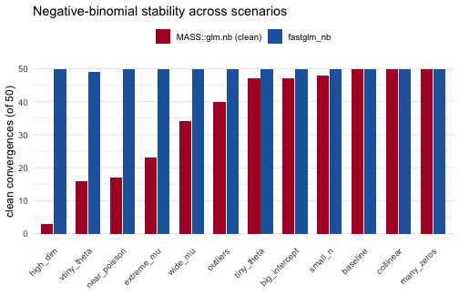
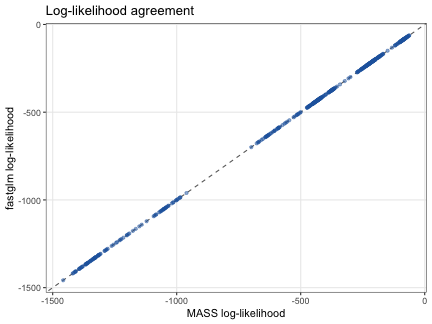
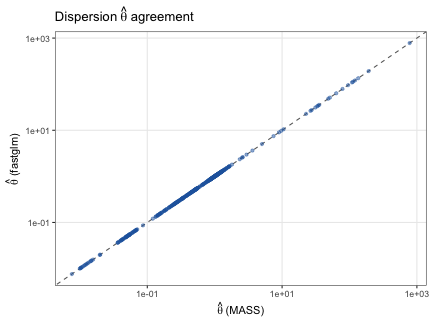

A negative-binomial regression estimates both the response mean and an additional parameter, theta, that determines variation beyond the Poisson model. Fitting alternates between weighted-regression updates of the coefficients with theta fixed and likelihood-based updates of theta with the fitted means fixed. This is called maximum likelihood estimation (MLE). The two updates can converge slowly when fitted means differ by many orders of magnitude or when theta approaches the Poisson limit. Step halving shortens an unsuccessful coefficient update, providing a safeguard against some numerical failures.

This vignette is a stability benchmark that sweeps a grid of twelve negative-binomial scenarios, each one chosen to stress the joint MLE in a different way (wide fitted-mean ranges, extreme over- and under-dispersion, small samples, high dimension, collinearity, and contaminating outliers). For each scenario we fit both solvers over many replications and tabulate how often each one converges cleanly, where one rescues the other, and whether the two reach the same likelihood maximum when both succeed.

The iteration settings differ in meaning between implementations: `MASS::glm.nb()` runs with `glm.control(maxit = 50)`, and `fastglm_nb()` uses its default `outer.maxit = 50`.

# Data-generating process

A single generator produces negative-binomial data with a log link. Its arguments vary each feature separately: the number of columns `p`, the true dispersion `theta`, the spread of the coefficients `coef_sd`, the intercept (which shifts the fitted-mean scale), an optional near-duplicate column (`collinear`), and an optional handful of extreme `outliers`.


``` r
library(fastglm)
suppressPackageStartupMessages(library(MASS))

gen <- function(seed, n, p, theta, coef_sd = 0.5, intercept = 1.0,
                collinear = FALSE, outliers = 0L, x_sd = 1.0) {
    set.seed(seed)
    X <- cbind(1, matrix(rnorm(n * (p - 1), sd = x_sd), n, p - 1))
    if (collinear && p >= 3) X[, p] <- X[, 2] + rnorm(n, sd = 1e-3)
    beta <- c(intercept, rnorm(p - 1, sd = coef_sd))
    eta  <- pmin(as.vector(X %*% beta), 12)
    mu   <- exp(eta)
    y    <- MASS::rnegbin(n, mu = mu, theta = theta)
    if (outliers > 0) {
        idx <- sample.int(n, outliers)
        y[idx] <- y[idx] + round(stats::rnbinom(outliers, size = theta,
                                                mu = max(mu) * 50))
    }
    list(X = X, y = y)
}
```

The twelve scenarios range from a well-conditioned reference case to designs intended to challenge the weighted-regression updates:


``` r
scen <- list(
  baseline      = list(n = 200, p = 3,  theta = 1,    coef_sd = 0.5),
  wide_mu       = list(n = 200, p = 9,  theta = 1,    coef_sd = 1.4, intercept = 4),
  extreme_mu    = list(n = 200, p = 12, theta = 1,    coef_sd = 1.6, intercept = 5),
  tiny_theta    = list(n = 200, p = 3,  theta = 0.05, coef_sd = 0.6),
  vtiny_theta   = list(n = 200, p = 3,  theta = 0.01, coef_sd = 0.6),
  near_poisson  = list(n = 200, p = 3,  theta = 5000, coef_sd = 0.5),
  small_n       = list(n = 40,  p = 5,  theta = 1,    coef_sd = 0.7),
  high_dim      = list(n = 120, p = 60, theta = 2,    coef_sd = 0.5),
  collinear     = list(n = 200, p = 6,  theta = 1,    coef_sd = 0.6, collinear = TRUE),
  outliers      = list(n = 200, p = 4,  theta = 1,    coef_sd = 0.5, outliers = 5L),
  big_intercept = list(n = 200, p = 4,  theta = 0.5,  coef_sd = 1.2, intercept = 6),
  many_zeros    = list(n = 200, p = 4,  theta = 0.3,  coef_sd = 0.6, intercept = -0.5)
)

descriptions <- c(
  baseline      = "well-conditioned reference case",
  wide_mu       = "fitted means span many orders of magnitude",
  extreme_mu    = "even wider mean range, p = 12",
  tiny_theta    = "heavy overdispersion (theta = 0.05)",
  vtiny_theta   = "extreme overdispersion (theta = 0.01)",
  near_poisson  = "nearly Poisson (theta = 5000)",
  small_n       = "small sample, n = 40",
  high_dim      = "high dimensional, p = 60",
  collinear     = "near-collinear design column",
  outliers      = "five extreme response outliers",
  big_intercept = "large intercept inflates the mean scale",
  many_zeros    = "low mean, many zeros (theta = 0.3)"
)
```

# Scoring convergence

For one simulated data set we fit both solvers and record, for each: whether it errored, whether it converged, whether *MASS* emitted an iteration- or step-limit warning, the maximized log-likelihood, the dispersion estimate, and the maximum relative coefficient discrepancy.

The packages are scored differently: *MASS* is counted as cleanly converged only when it returns a convergence flag without warnings, whereas *fastglm* is counted when it returns a convergence flag and finite coefficients. Consequently, these counts are not a comparison under identical success criteria. Theta estimates close to the Poisson limit also require separate interpretation because the data may provide little information about theta there.

Both log-likelihoods are evaluated with `dnbinom()` at each fit's fitted means and theta, rather than with each package's `logLik()` method, so that the two are computed identically. This matters near the Poisson limit: for one `near_poisson` data set, *MASS* estimates theta at about $3 \times 10^{10}$, and its `logLik()` value exceeds the Poisson maximum by about 0.002, which is not possible for a negative-binomial fit and reflects a loss of precision at that theta. When the likelihood is highest in the Poisson limit, `fastglm_nb()` returns `theta = Inf` with the Poisson fit, and `dnbinom()` with `size = Inf` equals the Poisson likelihood.


``` r
fit_both <- function(d) {
    X <- d$X; y <- d$y

    m_err <- FALSE; m_warn <- FALSE; m_conv <- FALSE
    m_ll <- NA_real_; m_th <- NA_real_; m_co <- NULL
    tryCatch(
        withCallingHandlers(
            {
                m <- MASS::glm.nb(y ~ X[, -1], control = glm.control(maxit = 50))
                m_conv <- isTRUE(m$converged)
                m_ll   <- sum(dnbinom(y, size = m$theta, mu = fitted(m), log = TRUE))
                m_th   <- m$theta
                m_co   <- coef(m)
            },
            warning = function(w) { m_warn <<- TRUE; invokeRestart("muffleWarning") }
        ),
        error = function(e) { m_err <<- TRUE }
    )

    f_err <- FALSE; f_conv <- FALSE
    f_ll <- NA_real_; f_th <- NA_real_; f_co <- NULL
    tryCatch({
        f <- fastglm_nb(X, y, link = "log")
        f_conv <- isTRUE(f$converged) && !any(is.nan(coef(f)))
        f_ll   <- sum(dnbinom(y, size = f$theta, mu = f$fitted.values, log = TRUE))
        f_th   <- f$theta
        f_co   <- as.numeric(coef(f))
    }, error = function(e) { f_err <<- TRUE })

    co_rel <- if (!is.null(m_co) && !is.null(f_co))
        max(abs(f_co - m_co) / (abs(m_co) + 1e-6)) else NA_real_

    c(m_err = m_err, m_warn = m_warn, m_conv = m_conv,
      f_err = f_err, f_conv = f_conv,
      m_ll = m_ll, f_ll = f_ll, m_th = m_th, f_th = f_th, co_rel = co_rel)
}
```

# Running the benchmark

Each scenario is replicated 50 times with distinct seeds, and the per-replication results are collapsed into the counts that matter for stability: how often *MASS* converges cleanly, how often *fastglm* converges, where *fastglm* rescues a *MASS* failure, where it loses, and, among the replications where both succeed, how often *fastglm*'s log-likelihood is at least as large as *MASS*'s.


``` r
n_reps <- 50
out <- data.frame()
reps <- data.frame()

for (nm in names(scen)) {
    s <- scen[[nm]]
    M <- t(vapply(seq_len(n_reps), function(r)
        fit_both(do.call(gen, c(list(seed = 10000 * match(nm, names(scen)) + r), s))),
        numeric(10)))
    df <- as.data.frame(M)
    reps <- rbind(reps, data.frame(scenario = nm, df))

    mass_ok    <- !df$m_err & df$m_conv & is.finite(df$m_ll)
    mass_clean <- mass_ok & !df$m_warn
    fg_ok      <- !df$f_err & df$f_conv & is.finite(df$f_ll)
    both       <- mass_ok & fg_ok

    fg_ge <- if (any(both)) sum(df$f_ll[both] >= df$m_ll[both] - 1e-3) else 0L
    co_ok <- if (any(both)) sum(df$co_rel[both] < 1e-2, na.rm = TRUE) else 0L

    out <- rbind(out, data.frame(
        scenario   = nm,
        mass_clean = sum(mass_clean),
        fg_conv    = sum(fg_ok),
        fg_rescue  = sum(!mass_clean & fg_ok),
        fg_lose    = sum(mass_clean & !fg_ok),
        both       = sum(both),
        fg_ge_ll   = fg_ge,
        coef_agree = co_ok
    ))
}
```

# Results


``` r
tab <- data.frame(
    Scenario   = out$scenario,
    Description = descriptions[out$scenario],
    `MASS clean` = out$mass_clean,
    `fastglm`    = out$fg_conv,
    Rescue       = out$fg_rescue,
    Lose         = out$fg_lose,
    `Both conv`  = out$both,
    `fg >= MASS` = out$fg_ge_ll,
    check.names  = FALSE
)
knitr::kable(
    tab, row.names = FALSE, align = "llrrrrrr",
    caption = sprintf(
        "Convergence over %d replications per scenario. 'MASS clean' = converged with no warning; 'fastglm' = converged with finite coefficients; 'Rescue' = fastglm converges where MASS does not; 'Lose' = MASS clean but fastglm fails; 'fg >= MASS' = replications (of 'Both conv') where fastglm's log-likelihood is at least MASS's.",
        n_reps)
)
```


Table: Convergence over 50 replications per scenario. 'MASS clean' = converged with no warning; 'fastglm' = converged with finite coefficients; 'Rescue' = fastglm converges where MASS does not; 'Lose' = MASS clean but fastglm fails; 'fg >= MASS' = replications (of 'Both conv') where fastglm's log-likelihood is at least MASS's.

|Scenario      |Description                                | MASS clean| fastglm| Rescue| Lose| Both conv| fg >= MASS|
|:-------------|:------------------------------------------|----------:|-------:|------:|----:|---------:|----------:|
|baseline      |well-conditioned reference case            |         50|      50|      0|    0|        50|         50|
|wide_mu       |fitted means span many orders of magnitude |         34|      50|     16|    0|        35|         35|
|extreme_mu    |even wider mean range, p = 12              |         23|      50|     27|    0|        29|         29|
|tiny_theta    |heavy overdispersion (theta = 0.05)        |         47|      50|      3|    0|        48|         48|
|vtiny_theta   |extreme overdispersion (theta = 0.01)      |         16|      49|     33|    0|        27|         27|
|near_poisson  |nearly Poisson (theta = 5000)              |         17|      50|     33|    0|        33|         33|
|small_n       |small sample, n = 40                       |         48|      50|      2|    0|        50|         50|
|high_dim      |high dimensional, p = 60                   |          3|      50|     47|    0|        24|         24|
|collinear     |near-collinear design column               |         50|      50|      0|    0|        50|         50|
|outliers      |five extreme response outliers             |         40|      50|     10|    0|        42|         42|
|big_intercept |large intercept inflates the mean scale    |         47|      50|      3|    0|        47|         47|
|many_zeros    |low mean, many zeros (theta = 0.3)         |         50|      50|      0|    0|        50|         50|


``` r
library(ggplot2)

plot_df <- rbind(
    data.frame(scenario = out$scenario, method = "MASS::glm.nb (clean)",
               count = out$mass_clean),
    data.frame(scenario = out$scenario, method = "fastglm_nb",
               count = out$fg_conv)
)
plot_df$scenario <- factor(plot_df$scenario, levels = out$scenario[order(out$mass_clean)])
plot_df$method   <- factor(plot_df$method,
                           levels = c("MASS::glm.nb (clean)", "fastglm_nb"))

ggplot(plot_df, aes(scenario, count, fill = method)) +
    geom_col(position = position_dodge(width = 0.75), width = 0.7) +
    scale_fill_manual(values = c("MASS::glm.nb (clean)" = "#b2182b",
                                 "fastglm_nb" = "#2166ac")) +
    labs(x = NULL, y = "clean convergences (of 50)", fill = NULL,
         title = "Negative-binomial stability across scenarios") +
    coord_cartesian(ylim = c(0, n_reps)) +
    theme_minimal(base_size = 12) +
    theme(axis.text.x = element_text(angle = 45, hjust = 1),
          legend.position = "top",
          panel.grid.major.x = element_blank())
```




Under these rules, *MASS* had 425 clean convergences and *fastglm* had 599 convergences among 600 simulated fits. *fastglm* converges where *MASS* does not in 174 replications and fails where *MASS* converges cleanly in 0. The differences are largest when fitted means vary widely, when theta is near an extreme, and when many coefficients are estimated from a limited sample. Because the two packages are scored under different criteria, these counts describe how often each returns a usable fit in these designs rather than a uniform ranking of reliability.

# Agreement when both methods converge

A convergence flag does not establish that a likelihood maximum has been reached, so the replications in which both methods converge are compared by their log-likelihoods. When one fit's log-likelihood is lower than the other's by more than 0.001, that fit has stopped short of the maximum or at a different, poorer point; the fits within 0.001 of each other are compared in detail.


``` r
mass_ok <- !reps$m_err & reps$m_conv & is.finite(reps$m_ll)
fg_ok   <- !reps$f_err & reps$f_conv & is.finite(reps$f_ll)
both    <- mass_ok & fg_ok
ll_diff <- reps$f_ll - reps$m_ll
mass_poorer <- both & ll_diff > 1e-3
fg_poorer   <- both & ll_diff < -1e-3
agree   <- both & abs(ll_diff) <= 1e-3
poisson_limit <- agree & is.infinite(reps$f_th)
finite  <- agree & is.finite(reps$f_th)
```

Both methods converge in 485 of 600 replications. In 17 of these, *MASS* reports convergence at a log-likelihood more than 0.001 below *fastglm*'s, and in 0 the reverse holds. *MASS* issued a warning in 17 of its 17 poorer fits. In 16 of them its log-likelihood is lower by more than one unit, in most cases with a theta estimate above $10^6$. In the remaining 1 (from the `high_dim` scenario), the two methods reach different local maxima of the profile likelihood of theta, and *fastglm*'s is higher by 0.95. Among the remaining 468 fits, the largest absolute difference in log-likelihood is 7.0e-04, and the mean absolute difference is 7.0e-06.


``` r
ggplot(reps[agree, ], aes(m_ll, f_ll)) +
    geom_abline(intercept = 0, slope = 1, colour = "grey40", linetype = 2) +
    geom_point(colour = "#2166ac", alpha = 0.5, size = 1.2) +
    labs(x = "MASS log-likelihood", y = "fastglm log-likelihood",
         title = "Log-likelihood agreement") +
    theme_bw(base_size = 11) + theme(panel.grid.minor = element_blank())
```



In 35 of the agreeing fits, the likelihood is highest in the Poisson limit: `fastglm_nb()` returns `theta = Inf`, and *MASS* returns a finite theta of at least 3.6e+06, a value at which the negative-binomial and Poisson likelihoods agree closely. These fits arise in the `near_poisson` and `high_dim` scenarios. For the 433 fits with a finite theta from both methods, the two estimates are compared below on a logarithmic scale; the largest relative difference is 1.3e-04.


``` r
ggplot(reps[finite, ], aes(m_th, f_th)) +
    geom_abline(intercept = 0, slope = 1, colour = "grey40", linetype = 2) +
    geom_point(colour = "#2166ac", alpha = 0.5, size = 1.2) +
    scale_x_log10() + scale_y_log10() +
    labs(x = expression(hat(theta) ~ "(MASS)"), y = expression(hat(theta) ~ "(fastglm)"),
         title = expression("Dispersion" ~ hat(theta) ~ "agreement")) +
    theme_bw(base_size = 11) + theme(panel.grid.minor = element_blank())
```




``` r
fg_only <- fg_ok & !mass_ok
fg_only_finite <- fg_only & is.finite(reps$f_th)
```

Of the 114 replications in which only `fastglm_nb()` converges, 43 are Poisson-limit fits, and the theta estimates of the others range from 0.00779 to 1.22.

# References

- Marschner, I. C. (2011). glm2: Fitting generalized linear models with convergence problems. *The R Journal*, 3(2), 12–15. <doi:10.32614/RJ-2011-012>

- Venables, W. N. and Ripley, B. D. (2002). *Modern Applied Statistics with S*, 4th edition. Springer, New York. <doi:10.1007/978-0-387-21706-2>
