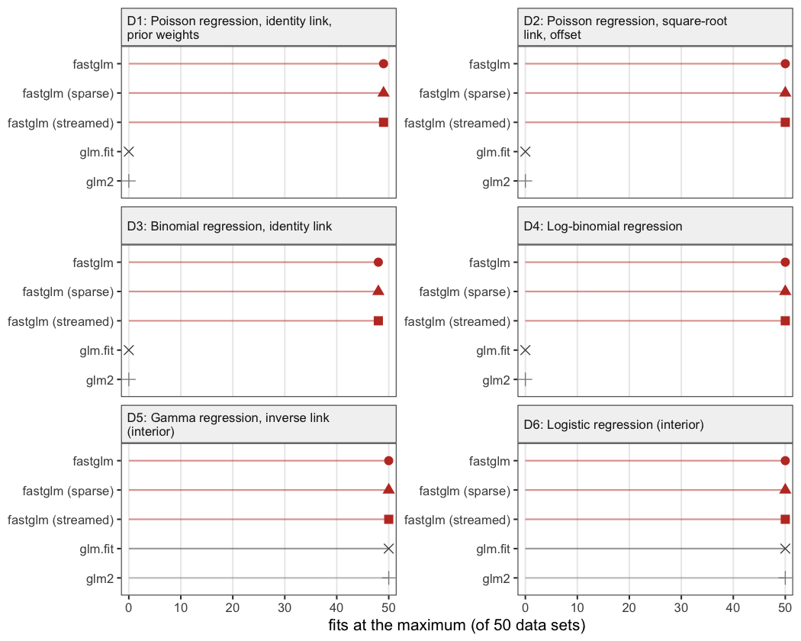
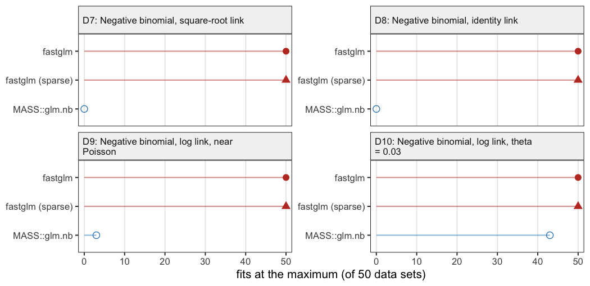
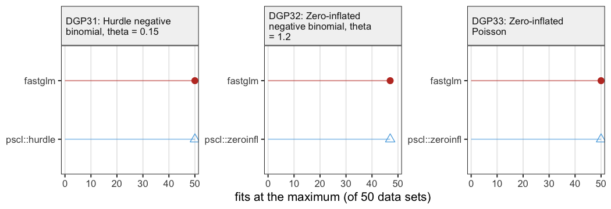
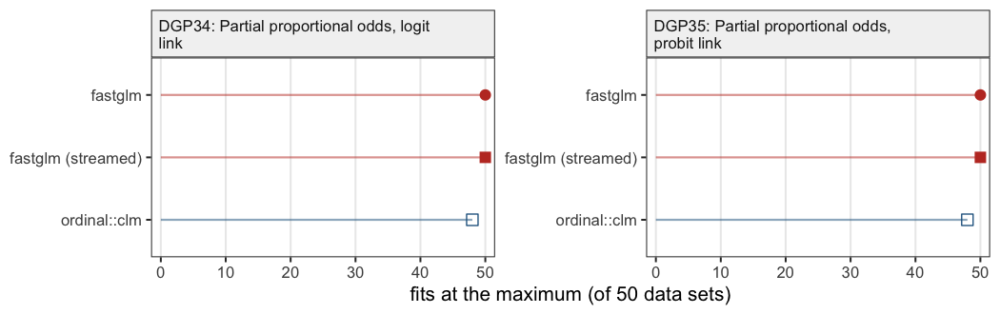
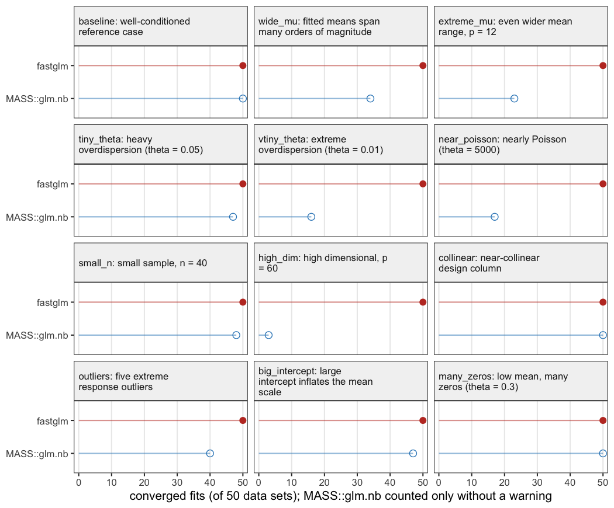

A fitted model is useful only if the reported estimate is the maximum of the likelihood, or the software says that it is not. This vignette describes how *fastglm* makes that distinction for generalized linear models, negative binomial, hurdle, zero-inflated, and ordinal models, and it reports a simulation study that compares *fastglm* with `stats::glm.fit()`, *glm2*, `MASS::glm.nb()`, *pscl*, and *ordinal* on designs where fitting is difficult.

# Failure modes of iteratively reweighted least squares

Most of these models are fit by iteratively reweighted least squares (IRLS), or by alternating such fits with updates of a dispersion or mixing parameter. Four problems recur.

- **Invalid steps.** Many links restrict the linear predictor: a square-root or identity link for Poisson data requires a positive mean, and a log link for binomial data requires probabilities below one. A full IRLS step can leave that region, and the software must shorten or redirect it.
- **Maxima on the boundary.** For such links the maximum itself can lie on the boundary of the valid region, for example where a fitted Poisson mean is zero. Halving the whole step every time it leaves the region then stalls the fit short of the maximum.
- **Flat likelihoods.** When the likelihood changes little in some direction, as it does in the dispersion parameter of a nearly Poisson negative binomial model, a rule based on the change in the coefficients or in the log likelihood can fail to stop, or can stop early.
- **False convergence.** If a step is shortened to nothing, the change between iterations is small wherever the fit stopped, and a rule based on that change reports convergence away from the maximum.

The first two are easy to see in a Poisson model with an identity link whose fitted mean reaches zero for some covariate values.


``` r
set.seed(1)
n <- 1000
x1 <- runif(n); x2 <- runif(n)
y <- rpois(n, pmax(0.3 + 2 * x1 - 1.6 * x2, 0.03))
X <- cbind(1, x1, x2)

tryCatch(glm.fit(X, y, family = poisson("identity")), error = conditionMessage)
#> Warning in log(y/mu): NaNs produced
#> [1] "no valid set of coefficients has been found: please supply starting values"

fit <- fastglm(X, y, family = poisson("identity"))
#> Warning: fastglm: the estimate is on the boundary of the valid region for this
#> family and link (convergence.reason = 'converged_boundary'); Wald standard
#> errors and tests are not reliable
c(converged = fit$converged, reason = fit$convergence.reason)
#>            converged               reason 
#>               "TRUE" "converged_boundary"
```

`glm.fit()` cannot find a valid starting point, while *fastglm* converges to the maximum, which lies on the boundary, and says so: the warning and `convergence.reason = "converged_boundary"` indicate that Wald standard errors do not have their usual justification for this estimate.

# Convergence checks and step safeguards in fastglm

*fastglm* reports convergence only when one more step is predicted to change the deviance negligibly (the Fisher or Newton decrement is below `tol` relative to the deviance), not merely when the last step changed little. Steps that leave the valid region are handled in three ways:

1. An invalid first update from the starting means is halved toward the intercept-only fit, which is valid whenever the mean response is.
2. When a later update leaves the region, the observation that leaves first is held partway to its bound and the step is recomputed for the remaining coefficients, so a fit whose maximum lies on the boundary reaches it. A held observation is released if its Lagrange multiplier shows that moving it back inside would improve the likelihood.
3. A step is used only if it decreases the deviance.

Models with an outer loop, such as the negative binomial dispersion or the zero-inflation mixture, use the same rule for the joint parameters, and the negative binomial fit also compares the Poisson limit (`theta = Inf`), where the likelihood can be highest. The reason for stopping is returned with the fit:

| `convergence.reason` | Meaning |
|---|---|
| `"converged"` | the maximum, certified by the decrement |
| `"converged_boundary"` | the maximum, on the boundary of the valid region (Wald inference not reliable) |
| `"theta_infinite"` | negative binomial: the likelihood is highest in the Poisson limit |
| `"theta_boundary"` | zero-inflated negative binomial: the zero-inflated Poisson limit |
| `"score_and_predictor_step"` | ordinal models: the maximum, certified by the score and step |
| `"iteration_limit"`, `"step_halving_failed"`, `"not_converged"`, `"ordering_boundary"` | not converged; the estimate is not certified as a maximum |

# Simulation study of convergence across model classes

The designs below were chosen to exercise these problems, and each was simulated 50 times.


``` r
designs <- unique(results[, c("design", "model", "label")])
designs <- designs[order(designs$design), ]
knitr::kable(data.frame(Design = designs$design, Model = designs$label), row.names = FALSE)
```


|Design |Model                                            |
|:------|:------------------------------------------------|
|D1     |Poisson regression, identity link, prior weights |
|D2     |Poisson regression, square-root link, offset     |
|D3     |Binomial regression, identity link               |
|D4     |Log-binomial regression                          |
|D5     |Gamma regression, inverse link (interior)        |
|D6     |Logistic regression (interior)                   |
|D7     |Negative binomial, square-root link              |
|D8     |Negative binomial, identity link                 |
|D9     |Negative binomial, log link, near Poisson        |
|D10    |Negative binomial, log link, theta = 0.03        |
|D11    |Hurdle negative binomial, theta = 0.15           |
|D12    |Zero-inflated negative binomial, theta = 1.2     |
|D13    |Zero-inflated Poisson                            |
|D14    |Partial proportional odds, logit link            |
|D15    |Partial proportional odds, probit link           |


Every fit is scored by a criterion computed from its coefficients, not by the value the package reports: minus the deviance for generalized linear models, the log likelihood otherwise, and for the hurdle model the log likelihood of the count part. The reference maximum for each data set is the best of an independent optimizer and all fits: a convex program (CVXR) for the generalized linear models, whose deviances are convex; an active-set constrained optimizer (SLSQP) or BFGS for the negative binomial models, with the Poisson limit as a candidate; BFGS from several starts for the hurdle and zero-inflated models; and a barrier method under the ordering constraints for the ordinal models. No reference was started at a *fastglm* solution. A fit is then

- **ok** if it is reported as converged and is within 1e-6 (relative) of the reference maximum;
- a **false convergence** if it is reported as converged and is further below;
- **not converged** if it is not reported as converged;
- an **error** if it stops with an error.


``` r
methods <- c(fastglm_dense = "fastglm", fastglm_sparse = "fastglm (sparse)",
             fastglm_stream = "fastglm (streamed)", glm.fit = "glm.fit", glm2 = "glm2",
             glm.nb = "MASS::glm.nb", hurdle = "pscl::hurdle", zeroinfl = "pscl::zeroinfl",
             clm = "ordinal::clm")
classes <- c("ok", "false convergence", "not converged", "error")
results$Method <- factor(methods[results$method], levels = methods)
results$Class <- factor(results$class, levels = classes)
# One row per design and method, one column per outcome class; the design is
# printed only on its first row.
summary_table <- function(model) {
  z <- results[results$model %in% model, ]
  out <- do.call(rbind, lapply(split(z, list(z$design, z$Method), drop = TRUE), function(r)
    data.frame(Design = r$design[1], Method = as.character(r$Method[1]),
               t(as.vector(table(r$Class))), check.names = FALSE)))
  out <- out[order(out$Design, factor(out$Method, levels = methods)), ]
  out$Design <- as.character(out$Design)
  out$Design[duplicated(out$Design)] <- ""
  knitr::kable(out, row.names = FALSE, align = "llrrrr",
               col.names = c("Design", "Method", "ok", "false convergence", "not converged", "error"))
}
# One palette for every figure: fastglm variants share the dominant colour and
# differ by shape; comparison packages use recessive greys and blues.
method_colour <- c("fastglm" = "#C0392B", "fastglm (sparse)" = "#C0392B", "fastglm (streamed)" = "#C0392B",
                   "glm.fit" = "#4A4A4A", "glm2" = "#8C8C8C", "MASS::glm.nb" = "#2E86C1",
                   "pscl::hurdle" = "#5DADE2", "pscl::zeroinfl" = "#5DADE2", "ordinal::clm" = "#1F618D")
method_shape <- c("fastglm" = 16, "fastglm (sparse)" = 17, "fastglm (streamed)" = 15,
                  "glm.fit" = 4, "glm2" = 3, "MASS::glm.nb" = 1, "pscl::hurdle" = 2,
                  "pscl::zeroinfl" = 2, "ordinal::clm" = 0)
# One panel per design and one row per method, so that no two methods share a
# position; a line from zero to each count makes the comparison by length.
plot_ok <- function(model, ncol = 2L) {
  z <- results[results$model %in% model, ]
  ok <- aggregate(cbind(ok = class == "ok") ~ design + label + Method, data = z, FUN = sum)
  ok$Method <- factor(ok$Method, levels = rev(levels(droplevels(ok$Method))))
  ok <- ok[order(ok$design), ]
  ok$panel <- factor(paste0(ok$design, ": ", ok$label), levels = unique(paste0(ok$design, ": ", ok$label)))
  ggplot(ok, aes(ok, Method, colour = Method, shape = Method)) +
    geom_segment(aes(x = 0, xend = ok, yend = Method), linewidth = 0.5, alpha = 0.5) +
    geom_point(size = 2.4) +
    facet_wrap(~ panel, ncol = ncol, scales = "free_y",
               labeller = label_wrap_gen(width = if (ncol > 2L) 26 else 40)) +
    scale_x_continuous(limits = c(0, 50), breaks = seq(0, 50, 10), expand = expansion(add = 1.5)) +
    scale_colour_manual(values = method_colour) + scale_shape_manual(values = method_shape) +
    labs(x = "fits at the maximum (of 50 data sets)", y = NULL) +
    theme_bw(base_size = 10) +
    theme(legend.position = "none", panel.grid.minor = element_blank(),
          panel.grid.major.y = element_blank(), strip.background = element_rect(fill = "grey95"),
          strip.text = element_text(hjust = 0))
}
```

## Generalized linear models

Designs D1 to D4 have maxima on the boundary of the valid region (identity and square-root links for Poisson data, identity and log links for binomial data); D5 and D6 are interior controls. *fastglm* was fit with a dense design, a sparse (`dgCMatrix`) design, and in four chunks with `fastglm_streaming()`.


``` r
summary_table("glm")
```


|Design |Method             | ok| false convergence| not converged| error|
|:------|:------------------|--:|-----------------:|-------------:|-----:|
|D1     |fastglm            | 49|                 0|             1|     0|
|       |fastglm (sparse)   | 49|                 0|             1|     0|
|       |fastglm (streamed) | 49|                 0|             1|     0|
|       |glm.fit            |  0|                 0|             0|    50|
|       |glm2               |  0|                 0|             0|    50|
|D2     |fastglm            | 50|                 0|             0|     0|
|       |fastglm (sparse)   | 50|                 0|             0|     0|
|       |fastglm (streamed) | 50|                 0|             0|     0|
|       |glm.fit            |  0|                 0|             0|    50|
|       |glm2               |  0|                 0|             0|    50|
|D3     |fastglm            | 49|                 0|             1|     0|
|       |fastglm (sparse)   | 49|                 0|             1|     0|
|       |fastglm (streamed) | 49|                 0|             1|     0|
|       |glm.fit            |  0|                 0|             0|    50|
|       |glm2               |  0|                 0|             0|    50|
|D4     |fastglm            | 50|                 0|             0|     0|
|       |fastglm (sparse)   | 50|                 0|             0|     0|
|       |fastglm (streamed) | 50|                 0|             0|     0|
|       |glm.fit            |  0|                 0|             0|    50|
|       |glm2               |  0|                 0|             0|    50|
|D5     |fastglm            | 50|                 0|             0|     0|
|       |fastglm (sparse)   | 50|                 0|             0|     0|
|       |fastglm (streamed) | 50|                 0|             0|     0|
|       |glm.fit            | 50|                 0|             0|     0|
|       |glm2               | 50|                 0|             0|     0|
|D6     |fastglm            | 50|                 0|             0|     0|
|       |fastglm (sparse)   | 50|                 0|             0|     0|
|       |fastglm (streamed) | 50|                 0|             0|     0|
|       |glm.fit            | 50|                 0|             0|     0|
|       |glm2               | 50|                 0|             0|     0|


``` r
plot_ok("glm")
```

<div class="figure">

<p class="caption">plot of chunk glm-plot</p>
</div>

On the boundary designs `glm.fit()` and *glm2* stop with an error in every data set, because the starting values or a later step leave the valid region; *fastglm* reaches the maximum in nearly all of them. The two *fastglm* fits that are not counted as ok, one in D1 and one in D3, stopped at the default iteration limit (100) within about 3e-6 (relative) of the maximum and are reported as not converged: Fisher scoring converges only linearly for non-canonical links, more slowly as fitted means approach a bound, and these fits converge at the maximum in 116 and 225 iterations with a larger `maxit`. On the interior designs all methods agree.

## Negative binomial models

D7 and D8 use square-root and identity links with maxima on the boundary, D9 is nearly Poisson (true `theta = 2000`), and D10 has strong overdispersion (`theta = 0.03`).


``` r
summary_table("nb")
```


|Design |Method           | ok| false convergence| not converged| error|
|:------|:----------------|--:|-----------------:|-------------:|-----:|
|D7     |fastglm          | 50|                 0|             0|     0|
|       |fastglm (sparse) | 50|                 0|             0|     0|
|       |MASS::glm.nb     |  0|                 0|             0|    50|
|D8     |fastglm          | 50|                 0|             0|     0|
|       |fastglm (sparse) | 50|                 0|             0|     0|
|       |MASS::glm.nb     |  0|                 0|             0|    50|
|D9     |fastglm          | 50|                 0|             0|     0|
|       |fastglm (sparse) | 50|                 0|             0|     0|
|       |MASS::glm.nb     |  3|                 0|            47|     0|
|D10    |fastglm          | 50|                 0|             0|     0|
|       |fastglm (sparse) | 50|                 0|             0|     0|
|       |MASS::glm.nb     | 43|                 0|             5|     2|


``` r
plot_ok("nb")
```

<div class="figure">

<p class="caption">plot of chunk nb-plot</p>
</div>


`MASS::glm.nb()` does not fit the square-root and identity designs, and near the Poisson limit it seldom reports convergence. In 42 of the 50 nearly Poisson data sets the likelihood is highest in the Poisson limit; *fastglm* returns `theta = Inf` there, with the Poisson fit and a warning.

## Hurdle and zero-inflated models


``` r
summary_table(c("hurdle", "zi"))
```


|Design |Method         | ok| false convergence| not converged| error|
|:------|:--------------|--:|-----------------:|-------------:|-----:|
|D11    |fastglm        | 50|                 0|             0|     0|
|       |pscl::hurdle   | 50|                 0|             0|     0|
|D12    |fastglm        | 50|                 0|             0|     0|
|       |pscl::zeroinfl | 50|                 0|             0|     0|
|D13    |fastglm        | 50|                 0|             0|     0|
|       |pscl::zeroinfl | 50|                 0|             0|     0|


``` r
plot_ok(c("hurdle", "zi"), ncol = 3L)
```

<div class="figure">

<p class="caption">plot of chunk count-plot</p>
</div>


The hurdle and zero-inflated fits agree with *pscl* in every data set. In 3 of the zero-inflated negative binomial data sets (D12) the likelihood is highest in the zero-inflated Poisson limit; *fastglm* stops with `theta` at its upper bound and `convergence.reason = "theta_boundary"`. Zero-inflated likelihoods can have several local maxima, and *fastglm* certifies a local maximum; it does not search among them.

## Ordinal models with threshold-specific effects

D14 and D15 are partial proportional odds models, where the cumulative probabilities must stay ordered at every observation; in some data sets the maximum lies where they touch.


``` r
summary_table("ordinal")
```


|Design |Method             | ok| false convergence| not converged| error|
|:------|:------------------|--:|-----------------:|-------------:|-----:|
|D14    |fastglm            | 50|                 0|             0|     0|
|       |fastglm (streamed) | 50|                 0|             0|     0|
|       |ordinal::clm       | 49|                 1|             0|     0|
|D15    |fastglm            | 50|                 0|             0|     0|
|       |fastglm (streamed) | 50|                 0|             0|     0|
|       |ordinal::clm       | 46|                 0|             3|     1|


``` r
plot_ok("ordinal")
```

<div class="figure">

<p class="caption">plot of chunk ordinal-plot</p>
</div>

*fastglm* reaches the maximum in every data set, certifying boundary maxima as `"converged_boundary"`. In one probit data set no observation with `z = 1` falls in the third category, so at the maximum the second and third cumulative probabilities coincide for all of those observations. The `ordinal::clm()` fit counted as a false convergence reports convergence at a point where the cumulative probabilities cross at some observations, which is outside the model.

## Summary

Across these designs, no *fastglm* fit was reported as converged away from the maximum. In every design, *fastglm* reached the maximum in at least 90% of the data sets and at least as often as each comparison method, and dense, sparse, and streamed *fastglm* fits that converged agree to 3.5e-9 (relative).

# Negative binomial fits across twelve scenarios

The twelve scenarios below, each with 50 data sets, vary one feature of a negative binomial design at a time. Both log likelihoods are evaluated with `dnbinom()` at each fit's estimates, because `logLik()` for `MASS::glm.nb()` loses precision at very large `theta`.


``` r
suppressPackageStartupMessages(library(MASS))
gen <- function(seed, n, p, theta, coef_sd = 0.5, intercept = 1.0,
                collinear = FALSE, outliers = 0L, x_sd = 1.0) {
    set.seed(seed)
    X <- cbind(1, matrix(rnorm(n * (p - 1), sd = x_sd), n, p - 1))
    if (collinear && p >= 3) X[, p] <- X[, 2] + rnorm(n, sd = 1e-3)
    beta <- c(intercept, rnorm(p - 1, sd = coef_sd))
    mu <- exp(pmin(as.vector(X %*% beta), 12))
    y <- MASS::rnegbin(n, mu = mu, theta = theta)
    if (outliers > 0) {
        idx <- sample.int(n, outliers)
        y[idx] <- y[idx] + round(stats::rnbinom(outliers, size = theta, mu = max(mu) * 50))
    }
    list(X = X, y = y)
}
scen <- list(
  baseline      = list(n = 200, p = 3,  theta = 1,    coef_sd = 0.5),
  wide_mu       = list(n = 200, p = 9,  theta = 1,    coef_sd = 1.4, intercept = 4),
  extreme_mu    = list(n = 200, p = 12, theta = 1,    coef_sd = 1.6, intercept = 5),
  tiny_theta    = list(n = 200, p = 3,  theta = 0.05, coef_sd = 0.6),
  vtiny_theta   = list(n = 200, p = 3,  theta = 0.01, coef_sd = 0.6),
  near_poisson  = list(n = 200, p = 3,  theta = 5000, coef_sd = 0.5),
  small_n       = list(n = 40,  p = 5,  theta = 1,    coef_sd = 0.7),
  high_dim      = list(n = 120, p = 60, theta = 2,    coef_sd = 0.5),
  collinear     = list(n = 200, p = 6,  theta = 1,    coef_sd = 0.6, collinear = TRUE),
  outliers      = list(n = 200, p = 4,  theta = 1,    coef_sd = 0.5, outliers = 5L),
  big_intercept = list(n = 200, p = 4,  theta = 0.5,  coef_sd = 1.2, intercept = 6),
  many_zeros    = list(n = 200, p = 4,  theta = 0.3,  coef_sd = 0.6, intercept = -0.5)
)
```


``` r
fit_both <- function(d) {
    X <- d$X; y <- d$y
    m_ok <- FALSE; m_warn <- FALSE; m_ll <- NA_real_
    tryCatch(withCallingHandlers({
        m <- MASS::glm.nb(y ~ X[, -1], control = glm.control(maxit = 50))
        m_ok <- isTRUE(m$converged)
        m_ll <- sum(dnbinom(y, size = m$theta, mu = fitted(m), log = TRUE))
    }, warning = function(w) { m_warn <<- TRUE; invokeRestart("muffleWarning") }),
    error = function(e) NULL)
    f_ok <- FALSE; f_ll <- NA_real_; f_inf <- FALSE
    tryCatch(suppressWarnings({
        f <- fastglm_nb(X, y)
        f_ok <- isTRUE(f$converged)
        f_ll <- sum(dnbinom(y, size = f$theta, mu = f$fitted.values, log = TRUE))
        f_inf <- is.infinite(f$theta)
    }), error = function(e) NULL)
    c(m_ok = m_ok && is.finite(m_ll), m_clean = m_ok && is.finite(m_ll) && !m_warn,
      f_ok = f_ok && is.finite(f_ll), f_inf = f_inf, m_ll = m_ll, f_ll = f_ll)
}
nb12 <- do.call(rbind, lapply(names(scen), function(nm) {
    M <- t(vapply(seq_len(50), function(r)
        fit_both(do.call(gen, c(list(seed = 10000 * match(nm, names(scen)) + r), scen[[nm]]))), numeric(6)))
    both <- M[, "m_ok"] == 1 & M[, "f_ok"] == 1
    data.frame(Scenario = nm, `MASS clean` = sum(M[, "m_clean"]), fastglm = sum(M[, "f_ok"]),
               `theta = Inf` = sum(M[, "f_inf"]), `Both` = sum(both),
               `fastglm lower` = sum(both & M[, "f_ll"] < M[, "m_ll"] - 1e-3),
               `MASS lower` = sum(both & M[, "m_ll"] < M[, "f_ll"] - 1e-3), check.names = FALSE)
}))
```


``` r
knitr::kable(nb12, row.names = FALSE)
```


|Scenario      | MASS clean| fastglm| theta = Inf| Both| fastglm lower| MASS lower|
|:-------------|----------:|-------:|-----------:|----:|-------------:|----------:|
|baseline      |         50|      50|           0|   50|             0|          0|
|wide_mu       |         34|      50|           0|   35|             0|          1|
|extreme_mu    |         23|      50|           0|   29|             0|          6|
|tiny_theta    |         47|      50|           0|   48|             0|          0|
|vtiny_theta   |         16|      50|           0|   27|             0|          9|
|near_poisson  |         17|      50|          32|   33|             0|          0|
|small_n       |         48|      50|           0|   50|             0|          0|
|high_dim      |          3|      50|          46|   24|             0|          1|
|collinear     |         50|      50|           0|   50|             0|          0|
|outliers      |         40|      50|           0|   42|             0|          0|
|big_intercept |         47|      50|           0|   47|             0|          0|
|many_zeros    |         50|      50|           0|   50|             0|          0|


``` r
descriptions <- c(
  baseline      = "well-conditioned reference case",
  wide_mu       = "fitted means span many orders of magnitude",
  extreme_mu    = "even wider mean range, p = 12",
  tiny_theta    = "heavy overdispersion (theta = 0.05)",
  vtiny_theta   = "extreme overdispersion (theta = 0.01)",
  near_poisson  = "nearly Poisson (theta = 5000)",
  small_n       = "small sample, n = 40",
  high_dim      = "high dimensional, p = 60",
  collinear     = "near-collinear design column",
  outliers      = "five extreme response outliers",
  big_intercept = "large intercept inflates the mean scale",
  many_zeros    = "low mean, many zeros (theta = 0.3)"
)
nb12_long <- rbind(
  data.frame(Scenario = nb12$Scenario, Method = "fastglm", count = nb12$fastglm),
  data.frame(Scenario = nb12$Scenario, Method = "MASS::glm.nb", count = nb12[["MASS clean"]]))
nb12_long$Method <- factor(nb12_long$Method, levels = c("MASS::glm.nb", "fastglm"))
nb12_long$panel <- factor(paste0(nb12_long$Scenario, ": ", descriptions[nb12_long$Scenario]),
                          levels = paste0(names(scen), ": ", descriptions[names(scen)]))
ggplot(nb12_long, aes(count, Method, colour = Method, shape = Method)) +
  geom_segment(aes(x = 0, xend = count, yend = Method), linewidth = 0.5, alpha = 0.5) +
  geom_point(size = 2.4) +
  facet_wrap(~ panel, ncol = 3, labeller = label_wrap_gen(width = 30)) +
  scale_x_continuous(limits = c(0, 50), breaks = seq(0, 50, 10), expand = expansion(add = 1.5)) +
  scale_colour_manual(values = method_colour) + scale_shape_manual(values = method_shape) +
  labs(x = "converged fits (of 50 data sets); MASS::glm.nb counted only without a warning", y = NULL) +
  theme_bw(base_size = 10) +
  theme(legend.position = "none", panel.grid.minor = element_blank(),
        panel.grid.major.y = element_blank(), strip.background = element_rect(fill = "grey95"),
        strip.text = element_text(hjust = 0))
```

<div class="figure">

<p class="caption">plot of chunk nb12-plot</p>
</div>

"MASS clean" counts `MASS::glm.nb()` fits reported as converged without a warning; "fastglm" counts converged *fastglm* fits; "Both" counts data sets where both report convergence; the last two columns count those where one log likelihood is lower than the other by more than 0.001. *fastglm* converges in 600 of 600 data sets and *MASS* without a warning in 425.

# Limitations

- Fisher scoring converges only linearly for non-canonical links, and fits whose fitted means approach a bound can need more than the default `maxit`; they are then reported as not converged.
- Zero-inflated fits certify a local maximum; the likelihood can have others.
- Bias-reduced fits (`firth = TRUE`) do not use the boundary step, and with identity, square-root, or log links whose estimate lies on the boundary they are reported as not converged.
- An estimate on the boundary of the valid region (`"converged_boundary"`, `"theta_infinite"`) is a maximum, but Wald standard errors and tests do not have their usual justification there.
